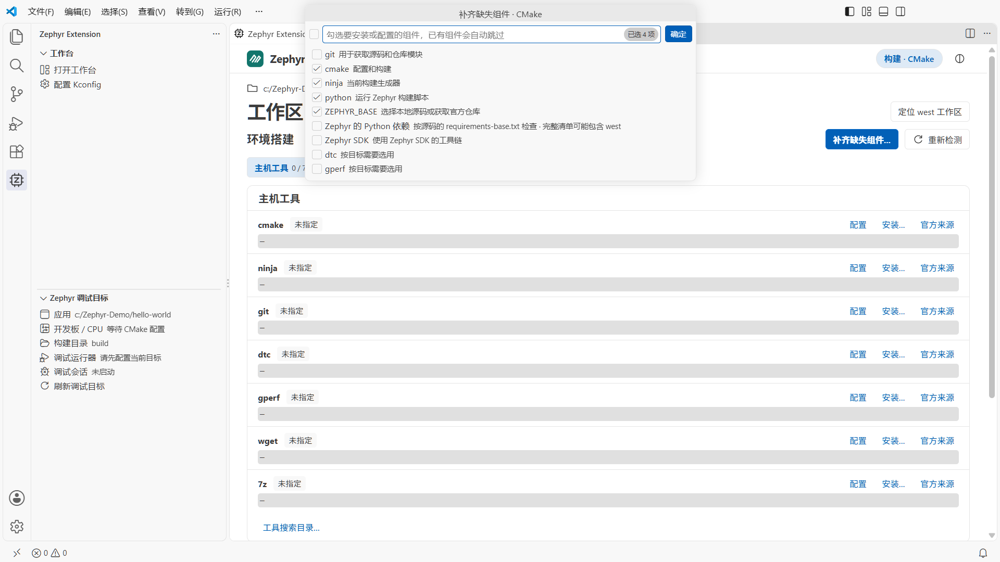

# Environment setup and platform checks for 0.5.17

[简体中文](platform-support.md) | **English**

Open Zephyr Extension from the VS Code Activity Bar, then choose **Workspace → Environment setup → Set up missing components**. To move to another computer, copy the same VSIX and install it from any directory. Choose a compiler, SDK and Python environment compatible with the new host. [Latest release](https://github.com/FormingSystem/zephyr-extension/releases/latest) · [User guide](../../extension/README.en.md)

## First use

1. On the Build page, select west or CMake. When you return to Workspace, the guide checks for missing components using the selected method, generator, available source and toolchain, and the last valid configuration. An offline CMake application can use local sources, modules and a cross-compiler.
2. Choose **Set up missing components** and select the items you need. Use the host package manager to install to its default locations, or select an existing executable, local installer and installation directory for each component. If the package manager itself is missing, follow its official download link or use tools already installed.
3. Under **Source and toolchain**, select an existing Zephyr checkout or choose an official release and destination directory. The west route initializes a workspace. The CMake route retrieves the source. Use the revision specified by your project when it requires a particular version.
4. The guide rechecks each component after setup. If you cancel, select an invalid directory or finish an installation that leaves the executable undiscoverable, the component stays on the list. Correct the location in the tool row and reopen the guide to continue. You can also supply a complete local SDK archive with its checksum list and a wheel directory for Python dependencies. Tool directories inside the project are saved relative to the project. External directories selected through the tool-directory picker stay in local workspace state.



## Platform differences

| Host | Getting the host tools | Probes and environment |
| --- | --- | --- |
| Windows 10 and 11 | Discover and run WinGet, or select an existing program, MSI or EXE. Select a destination when the installer supports a custom location. | Check Windows Plug and Play device information for probes. Register environment variables for the current user or the machine. |
| Ubuntu | Install distribution packages through APT or select a local DEB. Check that the current Python can create a virtual environment with pip. | Read USB devices from sysfs and use device-file permissions to diagnose access problems. Register user-session variables through systemd environment.d. |
| macOS | Discover Homebrew, user-selected tool directories and CMake.app. Use an existing program, PKG or DMG. For a DMG, open it and follow the vendor’s instructions. | Read USB devices from the I/O Registry and list serial ports. Variables set through launchctl apply to new processes launched in the current login session. |

The recommended SDK version comes from the checkout’s `SDK_VERSION`. The selector filters the assets actually published for that release by host OS and architecture. The Zephyr getting-started guide targets Ubuntu 24.04 LTS and later, and Apple Silicon Macs. On Ubuntu 22.04 or Intel Macs, choose a compatible toolchain for the Zephyr version in use. [Zephyr installation requirements](https://docs.zephyrproject.org/latest/develop/getting_started/index.html) · [Official SDK release assets](https://github.com/zephyrproject-rtos/sdk-ng/releases) · [Windows App Installer and WinGet](https://learn.microsoft.com/en-us/windows/package-manager/winget/)

## Writing bilingual GitHub release notes

Each stable release and prerelease has one version page with two collapsible sections, **简体中文** and **English**. Write the notes for that version in two UTF-8 Markdown files. Check that the changes, installation steps, test results and known limitations agree, including version numbers, commands and asset links.

From the repository root, run the following command with the file paths for this release.

```sh
python tools/release_notes.py --zh notes.zh.md --en notes.en.md --output release.md
```

Paste the contents of `release.md` into the GitHub release editor. In **Preview**, expand each language and check the formatting. With the GitHub CLI, pass the same file to `gh release create` or `gh release edit` using `--notes-file release.md`.

## Release package verification

Both test systems installed the same 0.5.17 VSIX, SHA-256 `ba3f65f214c6342540179b14adb92a72ffe23d9e702aa846ed6c222535390fba`. The checks scanned packaged text for development directories, user directories and tool paths from the build machine. The test moved the VSIX to a directory with spaces and Chinese characters, launched VS Code with an empty profile, opened the workbench, checked the bundled dependencies and used CMake and Ninja to build in a different directory.

| Platform | Installation and build results | Automated coverage |
| --- | --- | --- |
| Windows 11 Pro x64 | VS Code 1.148.0 opened the workbench. CMake 4.4.4 and Ninja built successfully. Standalone CMake used a local SDK and modules to produce a 382724-byte ARM ELF for `mps2/an386`. In an empty project with only system search paths, manually selecting a source checkout cleared the missing-source item. | 165 JavaScript tests passed. 13 Python tests passed and two Unix-only tests were skipped. |
| Ubuntu 24.04.5 LTS x86-64 VM | VS Code 1.148.0 opened the workbench on a 1920×1080 virtual display. CMake 3.28.3 and Ninja built successfully. Ubuntu’s Arm GCC 13.2.1, local source and CMSIS 6 produced a 367800-byte ARM ELF for the same target. | 164 JavaScript tests passed and one Windows-only test was skipped. All 15 Python tests passed. |
| Windows 10 x64, Windows 11 ARM64, Ubuntu 22.04, Intel and Apple Silicon macOS | Native installation results for these hosts were pending in this 0.5.17 review. | Platform jobs were provided. The Windows 10/11 x64 desktop jobs verify the actual OS version and client edition. |

Both ARM `hello_world` builds ran the CMake commands generated by the extension. Their caches recorded `WEST-NOTFOUND`. USB diagnostics verified host device enumeration. Writing firmware to a physical board still requires its probe.

To repeat the checks, install npm dependencies for the extension and the native tests, then run `python tests/native/check_host.py`. On a Windows desktop add `--windows-desktop 10` or `--windows-desktop 11` as appropriate. Check the package with `python tests/native/archive_paths.py <VSIX>`, then verify the actual installation with `node tests/native/workbench.cjs <VSIX>`. On a headless Linux host use `xvfb-run -a`. [Native test workflow](../../.github/workflows/native-platforms.yml) · [Test environment setup](../../.github/actions/check-extension/action.yml)

[简体中文](platform-support.md) | **English**
