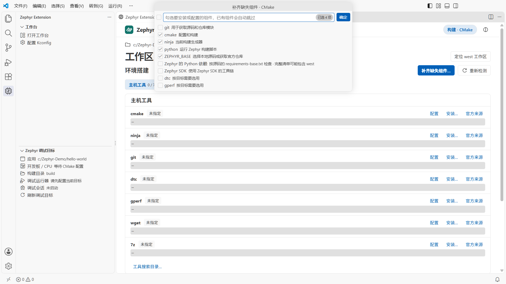

# 0.5.17 环境搭建与平台验收

**简体中文** | [English](platform-support.en.md)

从 VS Code 活动栏打开 Zephyr View，在「工作区 → 环境搭建」点击「补齐缺失组件」。换一台电脑时，可以把同一个 VSIX 复制过去并从任意目录安装。编译器、SDK 和 Python 环境应适配新的宿主系统。[当前发行包](https://github.com/FormingSystem/zephyr-extension/releases/latest) · [中英文使用手册](../../extension/README.md)

## 首次使用

1. 在「构建」选择 west 或 CMake。回到工作区后，缺项清单会采用当前方式、生成器、已有源码、工具链和上一次有效配置。使用 CMake 的离线应用可以复用本地源码、模块和交叉编译器。
2. 打开「补齐缺失组件」。选中所需项后，选择由包管理器安装到默认位置，或逐项指定已有程序、本地安装包和安装位置。官方包管理器缺失时，可以从其官方入口获取，或沿用本地工具。
3. 从「源码与工具链」选择已有的 Zephyr 源码，或指定官方发布版本与目标目录。west 方式初始化工作区，CMake 方式获取源码。在需要特定版本的项目中，以项目指定的版本为准。
4. 每一项完成后都会重新检测。取消、发现目录无效或安装后仍找不到程序时，向导列出待处理项。可在工具行修正位置，再打开向导继续。SDK 和 Python 依赖也支持本地完整包、校验清单及 wheel 目录。



## 系统差异

| 系统 | 获取主机工具 | 探针及环境 |
| --- | --- | --- |
| Windows 10、11 | 检测 WinGet 并调用。也可选已有程序、MSI 或 EXE。支持自定义位置的安装程序可选择目标目录。 | 从 Windows 的即插即用设备信息检查探针。环境变量可按当前用户或系统登记。 |
| Ubuntu | 用 APT 安装发行版工具包，或选择本地 DEB。检查当前 Python 能否创建带 pip 的虚拟环境。 | 通过 sysfs 读取 USB 设备，结合设备文件权限提示访问问题。用户会话环境可通过 systemd 的 environment.d 登记。 |
| macOS | 发现 Homebrew、用户指定的工具目录和 CMake.app。可使用已有程序、PKG 或 DMG，DMG 打开后按发行方指示操作。 | 从 I/O Registry 读取 USB 设备，并列出串口。launchctl 登记对当前登录会话新启动的进程生效。 |

SDK 按工程源码的 `SDK_VERSION` 推荐版本，再按该发布实际提供的宿主系统和架构筛选。Zephyr 的当前入门指南面向 Ubuntu 24.04 LTS 及以后版本、Apple Silicon Mac。Ubuntu 22.04 和 Intel Mac 用户应按所用 Zephyr 版本选择有兼容工具链的组合。[Zephyr 官方安装要求](https://docs.zephyrproject.org/latest/develop/getting_started/index.html) · [官方 SDK 发布附件](https://github.com/zephyrproject-rtos/sdk-ng/releases) · [Windows App Installer 与 WinGet](https://learn.microsoft.com/en-us/windows/package-manager/winget/)

## 在 GitHub 编写双语发布说明

正式版和预发布版都在同一个版本页提供「简体中文」和「English」两个折叠区。请为同一版本准备两份 UTF-8 Markdown 正文，逐项核对改动、安装步骤、验证结果和已知限制。两份正文使用同一版本号、命令和附件链接。

在仓库根目录运行下列命令，将文件名换成本次发布使用的路径。

```sh
python tools/release_notes.py --zh notes.zh.md --en notes.en.md --output release.md
```

把生成的 `release.md` 内容粘贴到 GitHub 发布编辑器，在 **Preview** 中分别展开两种语言检查排版。使用 GitHub CLI 时，通过 `--notes-file release.md` 将同一份说明传给 `gh release create` 或 `gh release edit`。

## 发布包验证

两台系统安装的是同一份 0.5.17。SHA-256 为 `ba3f65f214c6342540179b14adb92a72ffe23d9e702aa846ed6c222535390fba`。包内文本已检查开发目录、用户目录和构建机工具路径。测试将 VSIX 搬到含空格和中文的目录，用空白配置启动 VS Code，检查工作台、扩展内置依赖，以及在另一目录调用 CMake 和 Ninja 的实际构建结果。

| 平台 | 安装与构建结果 | 自动化覆盖 |
| --- | --- | --- |
| Windows 11 专业版 x64 | VS Code 1.148.0 打开工作台，CMake 4.4.4 和 Ninja 构建成功。独立 CMake 配置使用本地 SDK 与模块，为 `mps2/an386` 生成 382724 字节 ARM ELF。在只保留系统搜索路径的空工程中，手动接入源码后该项从缺项中消失。 | JavaScript 165 项通过。Python 13 项通过，2 项 Unix 专用测试跳过。 |
| Ubuntu 24.04.5 LTS x86-64 虚拟机 | VS Code 1.148.0 在 1920×1080 虚拟显示器打开工作台，CMake 3.28.3 与 Ninja 构建成功。使用 Ubuntu 的 Arm GCC 13.2.1、本地源码和 CMSIS 6，为相同目标生成 367800 字节 ARM ELF。 | JavaScript 164 项通过，1 项 Windows 专用测试跳过。Python 15 项通过。 |
| Windows 10 x64、Windows 11 ARM64、Ubuntu 22.04、macOS Intel 和 Apple Silicon | 本次尚无这些平台的原生安装实测结果。 | 已提供平台任务。Windows 10/11 x64 桌面任务会核对实际系统版本及客户端类型。 |

两次 ARM 固件构建均通过扩展生成的 CMake 命令完成，缓存中记录 `WEST-NOTFOUND`。USB 诊断验证了系统枚举；向实体板写入固件仍需接入对应探针。

复测时，先安装扩展和原生测试的 npm 依赖，再运行 `python tests/native/check_host.py`。在 Windows 桌面分别加 `--windows-desktop 10` 或 `--windows-desktop 11`。用 `python tests/native/archive_paths.py <VSIX>` 检查发布包，再用 `node tests/native/workbench.cjs <VSIX>` 验证实际安装；Linux 无显示器时可使用 `xvfb-run -a`。[原生测试工作流](../../.github/workflows/native-platforms.yml) · [测试环境准备](../../.github/actions/check-extension/action.yml)

工具目录在项目内时保存为相对路径。在工具目录选择器中选定的外部目录保存在本机工作区状态。上述 Windows 和 Ubuntu 的 ARM 固件构建使用 Zephyr 的 `hello_world` 应用。

**简体中文** | [English](platform-support.en.md)
