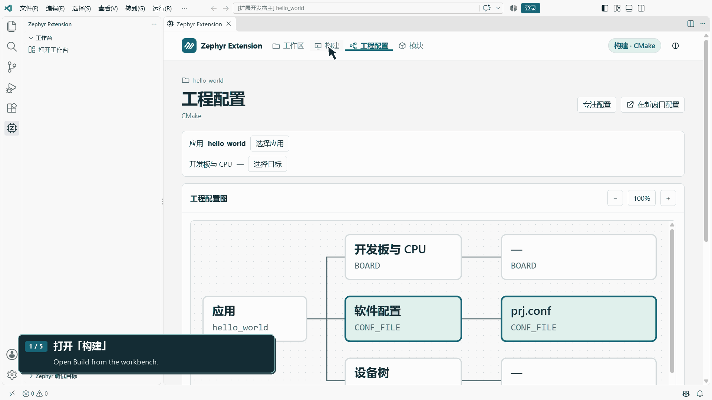
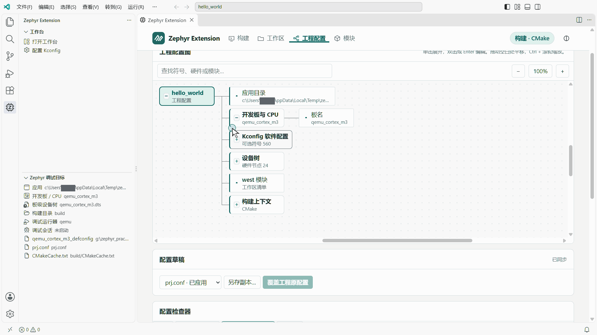

# Getting started with Zephyr View: build your first firmware

[简体中文](GETTING_STARTED.md) | **English**

Start with a supported board and build one working image. Then add a module, change a configuration option or bring in your own hardware. The examples and animations ship with the extension. Reopen this page from **Getting started** in the Zephyr View sidebar or from the Command Palette.

## Make a writable copy

Press `F1` in VS Code and run **Zephyr View: Copy Tutorial Examples…**. Choose a writable directory, then select **Open examples in a new window**. The new `zephyr-view-examples` folder contains two exercises:

- `onboarding/app` is the application. `onboarding/modules/greeting` is a separate library you can integrate into it.
- `hardware-port` is a complete out-of-tree hardware package that exports a teaching board and a Cortex-M3 teaching SoC.

## Choose a task

| What you want to do | Where to go | How to check the result |
| --- | --- | --- |
| Build two threads and follow a value | Threads → Program draft, then Source analysis and Paused stack | Follow the queue receive call to `value = 42` in the debugger. [Thread tutorial](guides/threads.en.md) |
| Initialize, open or repair a west workspace | Workspace → west workspace | The expected workspace root and manifest file appear. [Workspace walkthrough and animation](guides/west-workspace.en.md) |
| Build with existing sources and an SDK, or choose another compiler | Review tools in Workspace, then select a build method and target compiler on Build | `CMakeCache.txt` shows the actual `CMAKE_C_COMPILER`. [Compiler example and animation](guides/cmake-integration.en.md) |
| Add a local library and decide whether its sources compile | Modules → Select directory, then edit Kconfig under Project configuration | When enabled, `greeting.c` appears in the compile commands and the output changes in the emulator. [Local module and build options exercise](guides/cmake-integration.en.md) |
| Discover your own board and SoC in the target picker | Add the hardware package in Modules, then choose the target on Build | The list contains `view_lab/view_m3`. The generated DTS describes that board. [Board and SoC porting example and animation](guides/hardware-port.en.md) |

## Build your first image

1. Open **Zephyr View → Open workbench → Workspace** from the Activity Bar. Check the detected Zephyr sources, SDK and Python. You can point to existing local tools or install missing components under **Environment setup**. Check that the tools and build settings belong to your project.
2. Open **Build**. Choose **west** for an existing west workspace, or **CMake** for a standalone setup with local sources and modules. Select `onboarding/app` as the application and search for the `mps2/an386` board target. Choose a fresh build directory, such as `build/first`.
3. Review the recommended **Target compiler** and its executable. Leave parallel jobs on **Automatic** for the first build. With standalone CMake, prepare the local modules your board needs as described in the [offline example](guides/cmake-integration.en.md).
4. Choose **Configure**, then **Build**. The terminal should report linking `zephyr.elf`. Inspect `zephyr/.config` in the build directory for the board and architecture, and `zephyr/zephyr.dts` for hardware. To see serial output, run the example with QEMU as shown in the compiler guide.
5. Choose a fresh build directory when switching boards or toolchains. Keeping both directories makes it easier to compare their build settings and images. If configuration fails, start at the first relevant terminal error or use the action beside the missing prerequisite on Build.

## Change an option and check the firmware

Open **Project configuration** and expand **Kconfig**. In a project with the greeting module included, search for `ONBOARDING_GREETING`, double-click the symbol, enable it and stage the change. Review the diff, then save a copy or write to the selected application configuration file. If you save a separate fragment, include it on Build or set `EXTRA_CONF_FILE` as shown in the guide.

Configure and build again. The generated `zephyr/.config` should contain `CONFIG_ONBOARDING_GREETING=y`. If the symbol is missing, check for the module in `zephyr_modules.txt`, then verify the active application, board and Kconfig dependencies. To explore drivers and peripherals, expand **Devicetree** on the same map, select a node and edit an overlay draft. After saving and configuring, verify it in `zephyr/zephyr.dts`. Zephyr selects the base DTS when you select a board.

[Full extension manual online](https://github.com/FormingSystem/Zephyr-View/blob/main/extension/README.en.md) · [Zephyr Getting Started Guide](https://docs.zephyrproject.org/latest/develop/getting_started/index.html)

[简体中文](GETTING_STARTED.md) | **English**
