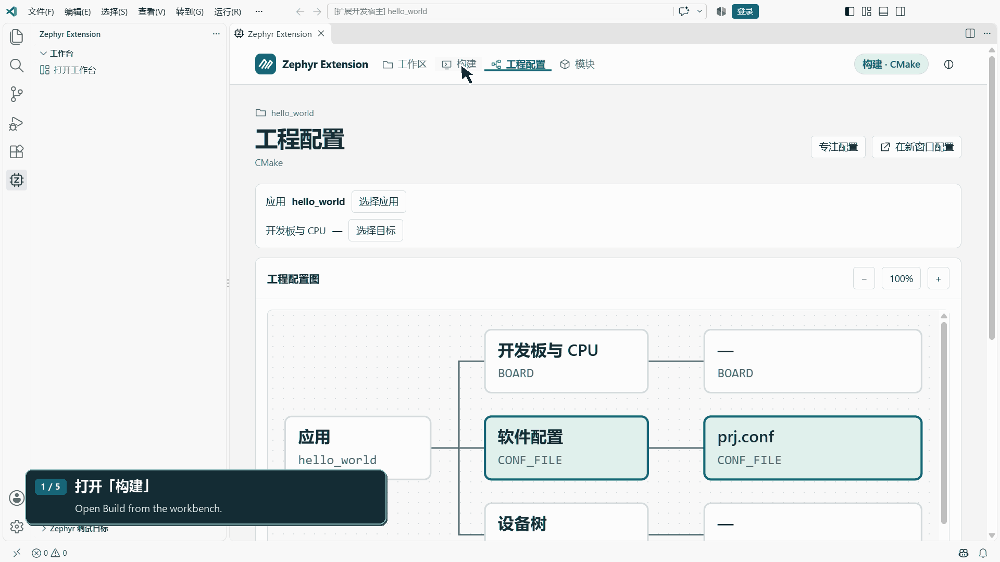
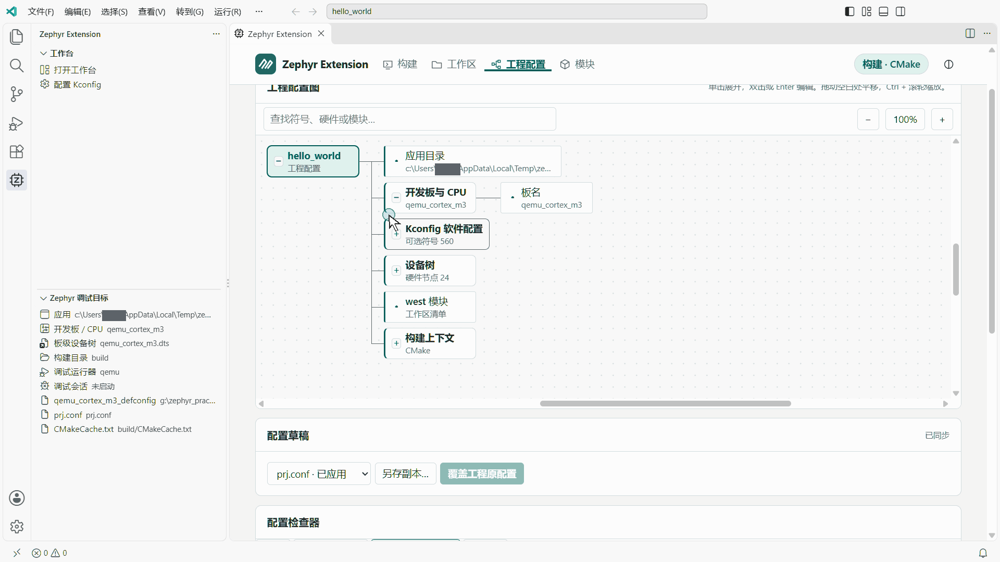

# Zephyr View 入门：从安装到第一份固件

**简体中文** | [English](GETTING_STARTED.en.md)

第一次使用时，先完成一次现成开发板的构建。能得到固件以后，再换模块、改配置或加入自己的硬件。所有示例和动图随扩展安装。以后可在 Zephyr View 左栏点击 **入门指南**，也可以从命令面板打开它。

## 先准备一个可以修改的副本

在 VS Code 按 `F1`，运行 **Zephyr View: 复制入门示例…**，选择一个可写目录，然后点 **在新窗口打开示例**。生成的 `zephyr-view-examples` 中包含以下练习。

- `onboarding/app` 是要编译的应用，`onboarding/modules/greeting` 是可以接进应用的独立库。
- `hardware-port` 是一个完整的树外硬件包，导出一块教学板和一颗 Cortex-M3 教学 SoC。
- `visual-program` 包含可编辑的示例程序图和 QEMU 控制台记录。在程序设计器点击「播放固件示例」即可并排对照节点和运行值。

## 我接下来该点哪里？

| 你现在要做什么 | 工作台入口 | 完成时能看到什么 |
| --- | --- | --- |
| 在图上编写程序、追踪消息 | 编程工作室 → 文件 → 播放固件示例 | 单步查看发送、接收和函数返回值。用「新建设计 → 枚举与位标志」练习自定义类型，在手写 C 文件中打开「实时 C 源码图」。[程序设计器动图与练习](guides/visual-program.md) |
| 创建双线程示例，跟踪一个数值 | 编程工作室 → 工具 → 分析工程并发 → 编程草稿，随后进入工程分析和暂停栈 | 从队列接收端的源码追到调试器里的 `value = 42`。[线程练习](guides/threads.md) |
| 初始化、打开或修复 west 工作区 | 工作区 → west 工作区 | 显示正确的工作区根和清单文件。[工作区操作动图与手册](guides/west-workspace.md) |
| 用现成源码和 SDK 编译应用，或改用另一套编译器 | 工作区核对工具，构建页选择构建方式和目标编译器 | `CMakeCache.txt` 中的 `CMAKE_C_COMPILER` 指向实际使用的编译器。[编译器接入示例与动图](guides/cmake-integration.md) |
| 把本地库加入工程，按选项决定是否编译 | 模块 → 选择目录，再在工程配置中编辑 Kconfig | 选项启用后，`greeting.c` 出现在编译命令中。模拟器里能看到输出改变。[本地模块与编译选项练习](guides/cmake-integration.md) |
| 让选板列表识别自己的板和 SoC | 模块页加入硬件包，构建页选择目标 | `view_lab/view_m3` 出现在列表中，生成的 DTS 对应这块板。[板包和 SoC 移植示例与动图](guides/hardware-port.md) |

## 第一次构建

1. 点活动栏的 **Zephyr View → 打开工作台 → 工作区**。核对检测到的 Zephyr 源码、SDK 和 Python。已有工具可以指定本地位置；缺少的组件可在「环境搭建」中逐项补齐。确认工具和构建配置属于你正在使用的工程。
2. 打开 **构建**。已有 west 工作区可选择 **west**。使用独立源码和本地模块可选择 **CMake**。把应用设为 `onboarding/app`，搜索并选择 `mps2/an386`。使用新的构建目录，例如 `build/first`。
3. 查看 **目标编译器** 的推荐结果和可执行文件。并行任务数先保留「自动」。如果选择独立 CMake，请按[离线示例](guides/cmake-integration.md)准备这个目标所需的本地模块。
4. 点击 **配置**。成功后点击 **构建**，终端末尾应显示链接 `zephyr.elf`。在构建目录打开 `zephyr/.config` 检查板和架构，在 `zephyr/zephyr.dts` 检查硬件。要观察串口输出，可按编译器手册用 QEMU 运行示例。
5. 切换板或工具链时，选一个新的构建目录。保留两个目录就能比较编译选项和生成固件。配置失败时，从终端第一条相关错误开始核对，或按构建页在缺项旁给出的操作补齐。

## 改一个配置，确认它进了固件

打开 **工程配置**，展开 **Kconfig 软件配置**。在已接入 greeting 模块的工程中搜索 `ONBOARDING_GREETING`，双击符号、选择启用并将改动加入草稿。先看差异，然后选择「另存副本」或写回所选的应用配置文件。若另存了片段，需要回到构建页将它加入本次构建，或者按手册设置 `EXTRA_CONF_FILE`。

重新配置并构建后，`zephyr/.config` 应包含 `CONFIG_ONBOARDING_GREETING=y`。如果选项没有出现，先检查生成的 `zephyr_modules.txt` 是否列出模块，然后核对当前应用、板和 Kconfig 依赖。想学习驱动和外设，可在同一张图里展开 **设备树**，选择节点修改 overlay 草稿，保存后在 `zephyr/zephyr.dts` 核对。选板后，Zephyr 会自动加载它的基础 DTS。

[在线完整手册](https://github.com/FormingSystem/Zephyr-View/blob/main/extension/README.md) · [Zephyr 官方入门指南](https://docs.zephyrproject.org/latest/develop/getting_started/index.html)

**简体中文** | [English](GETTING_STARTED.en.md)
