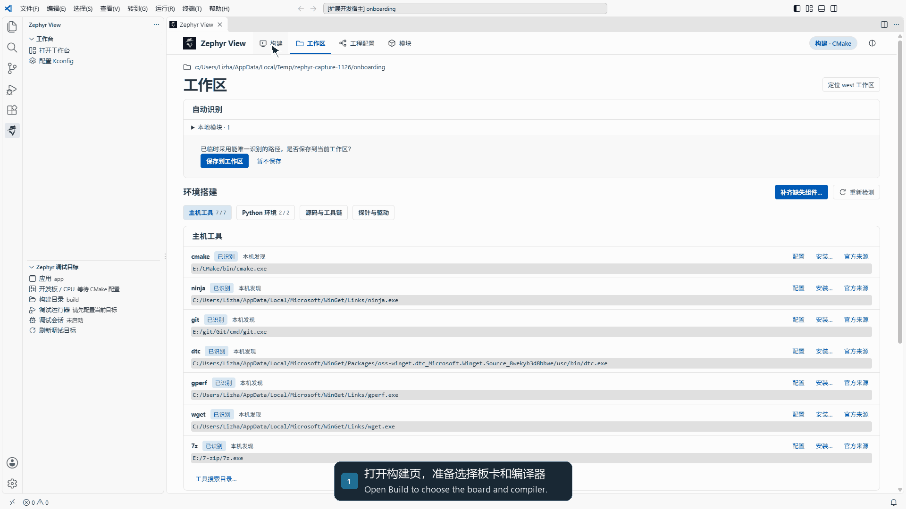
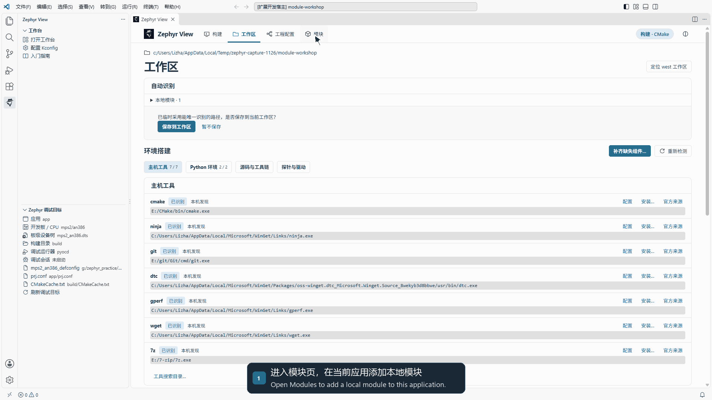

# Connect a compiler and a local module to a Zephyr CMake application

[简体中文](cmake-integration.md) | **English**

Build a Cortex-M4 application that runs in QEMU. First it prints `Application only`. Then you enable a local library and the same application prints `Hello from the local module`. Start in Zephyr View, or reproduce the steps with the terminal commands below.

## Make a working copy

Run **Zephyr View: Copy Tutorial Examples…** from the Command Palette. Choose a writable destination and open the new `zephyr-view-examples` folder. Run `cd onboarding` in its terminal. You can also copy the whole [onboarding example](../examples/onboarding) from the repository and start your terminal there. The example has two parts:

- [app](../examples/onboarding/app) is the application. Its `find_package(Zephyr REQUIRED HINTS $ENV{ZEPHYR_BASE})` loads the build system from your chosen Zephyr source tree. `target_sources(app PRIVATE src/main.c)` adds the entry point to the application target.
- [modules/greeting](../examples/onboarding/modules/greeting) is a separate module. It contains `zephyr/module.yml`, `Kconfig` and `CMakeLists.txt`. If you move it, select its new directory.

Under **Workspace → Environment setup**, check CMake, Ninja, a Python installation with Zephyr's build dependencies, the Zephyr source tree and an SDK for your host. To run the firmware, install the QEMU ARM system emulator. The target for this lab is `mps2/an386`. Building it fully offline with Zephyr 4.5.0-rc1 also requires the `cmsis_6` source at the revision in that Zephyr checkout's manifest. Other boards and Zephyr versions can require different modules. [Zephyr application development](https://docs.zephyrproject.org/latest/develop/application/index.html) · [Zephyr SDK](https://docs.zephyrproject.org/latest/develop/toolchains/zephyr_sdk.html)

## Choose a target, a compiler and a build option in the workbench

1. Open **Build**, choose **CMake** or **west**, and select `app` as the application directory. In the board picker, search for and select `mps2/an386`. Choose a fresh build directory, for example `build/sdk-off`.
2. Find **Target compiler**. With the SDK’s GNU toolchain for ARM installed, the recommended compiler for this board is `arm-zephyr-eabi-gcc`. Keep the automatic selection or choose and apply an external GNU compiler. When changing compilers, select a different build directory such as `build/external-on`.
3. Under **Modules**, select the local `modules/greeting` directory and check it. A west build keeps the existing manifest modules. A CMake build can discover those same modules when its Python has west installed and can find the west workspace from `ZEPHYR_BASE`. For a fully offline build that discovers no manifest modules and has no primary module list supplied by the project, select the complete set of local dependencies for your board. For this example, also check `cmsis_6`.
4. Choose **Configure**. Check the recorded `CMAKE_C_COMPILER` and board target, then choose **Build**. By default only `prj.conf` supplies the application settings. This first firmware prints `Application only`. Parallel jobs can stay on **Auto**. Selecting 4 allows up to four compiler jobs on the host.
5. In **Project Configuration**, open the Kconfig branch, search for `ONBOARDING_GREETING`, enable it, review the draft and save to the application configuration. To try the same change while preserving `prj.conf`, enter `EXTRA_CONF_FILE=enable-greeting.conf` on its own line under **Additional CMake definitions** on the Build page. This applies the supplied fragment. Configure and build again. The firmware now prints the module’s greeting.

**Choose a compiler and check the recorded build configuration**



**Include a local module in the current build**



## Trace an option from the input file to the firmware

| Input | How Zephyr and CMake use it | Where to check |
| --- | --- | --- |
| `BOARD=mps2/an386` and the toolchain variant | The board and SoC identify the Cortex-M4 architecture. The toolchain variant finds the compiler, linker and companion tools. | Find `CMAKE_C_COMPILER` in the build directory's `CMakeCache.txt`, then find `-mcpu=cortex-m4` for `main.c` in `compile_commands.json`. |
| [zephyr/module.yml](../examples/onboarding/modules/greeting/zephyr/module.yml) | `name` identifies the module. `build.cmake: .` selects its root, while `build.kconfig: Kconfig` locates its option definitions. Both paths are relative to the module root. | Look for `onboarding_greeting` and its directory in the build directory's `zephyr_modules.txt`. |
| [Kconfig](../examples/onboarding/modules/greeting/Kconfig) and [enable-greeting.conf](../examples/onboarding/app/enable-greeting.conf) | The module declares a boolean that defaults to off. The application fragment sets `CONFIG_ONBOARDING_GREETING` to `y`. | In `zephyr/.config`, look for `CONFIG_ONBOARDING_GREETING=y` or `# CONFIG_ONBOARDING_GREETING is not set`. |
| [Module CMakeLists.txt](../examples/onboarding/modules/greeting/CMakeLists.txt) and [application entry point](../examples/onboarding/app/src/main.c) | When enabled, the module exports its public include directory, creates a Zephyr library and compiles `src/greeting.c`. The application uses the same flag to call its function. | `greeting.c` appears in `compile_commands.json` only when enabled. Running the resulting `zephyr/zephyr.elf` prints the module message. |

To port your own library, point `module.yml` at its CMake and Kconfig entry points. Add the actual source files with `zephyr_library_sources()`. Use `CONFIG_` in application fragments and omit the prefix when declaring the symbol in Kconfig. For a flag that should affect only this library, use `zephyr_library_compile_options(...)` after `zephyr_library()`. [Zephyr module integration](https://docs.zephyrproject.org/latest/develop/modules.html) · [Kconfig configuration and merging](https://docs.zephyrproject.org/latest/build/kconfig/setting.html)

## Repeat the build from a terminal

Activate a Python environment with the Zephyr dependencies and make sure CMake and Ninja are available. Set `ZEPHYR_BASE` to the Zephyr source root containing `VERSION` and `share/zephyr-package`. For an unregistered SDK, set `ZEPHYR_SDK_INSTALL_DIR` to the SDK root. If a workbench task uses different environment values from your terminal, set the terminal values separately. From the example copy, capture its absolute locations so the same variables work after changing directory.

**PowerShell**

```powershell
$lab = (Get-Location).Path
$greeting = (Resolve-Path ./modules/greeting).Path.Replace('\', '/')
```

**Bash / zsh**

```sh
lab="$PWD"
greeting="$lab/modules/greeting"
```

**A · Existing west workspace.** In the same terminal, change to an initialized west workspace and run:

```sh
west build -b mps2/an386 -d "$lab/build/west-on" "$lab/app" -- "-DEXTRA_ZEPHYR_MODULES=$greeting" -DEXTRA_CONF_FILE=enable-greeting.conf
```

Arguments before `--` go to west; those after it go to CMake. `EXTRA_ZEPHYR_MODULES` appends the local module to the modules discovered from the manifest. Run `west build -d "$lab/build/west-on" -t run` to start QEMU. Press `Ctrl+A` followed by `X` to exit. [west build options](https://docs.zephyrproject.org/latest/develop/west/build-flash-debug.html)

**B · Standalone CMake with the SDK.** Return to the example copy. Supply the existing **module root** for `cmsis_6` on your machine, the folder containing `zephyr/module.yml`. You can copy its path from your file manager. In a fully offline build, `ZEPHYR_MODULES` must list all modules required by the selected board and application.

```powershell
$cmsis = (Resolve-Path (Read-Host 'cmsis_6')).Path.Replace('\', '/')
```

```sh
# Bash / zsh
printf 'cmsis_6: '; IFS= read -r cmsis
```

The following commands work in either shell. The quotes pass the semicolon-separated list to CMake as one argument.

```sh
cmake -S app -B build/sdk-off -G Ninja -DBOARD=mps2/an386 -DZEPHYR_TOOLCHAIN_VARIANT=zephyr "-DZEPHYR_MODULES=$cmsis;$greeting"
cmake --build build/sdk-off --parallel 4
cmake --build build/sdk-off --target run
```

Observe `Application only` and exit the emulator. Enable the feature and repeat:

```sh
cmake -S app -B build/sdk-off -DEXTRA_CONF_FILE=enable-greeting.conf
cmake --build build/sdk-off --parallel 4
cmake --build build/sdk-off --target run
```

To turn it off again, run `cmake -S app -B build/sdk-off -DEXTRA_CONF_FILE=` and rebuild. To reproduce a first configure, select a new build directory. [Specifying modules without west](https://docs.zephyrproject.org/latest/develop/modules.html#without-west)

**Choose a debug optimization level.** The sample [debug.conf](../examples/onboarding/app/debug.conf) enables `CONFIG_DEBUG_OPTIMIZATIONS`. To enable both the module and debug optimizations, enter `EXTRA_CONF_FILE=enable-greeting.conf;debug.conf` under **Additional CMake definitions**. Alternatively, run the two commands below after path B. In `compile_commands.json`, inspect the command for `greeting.c`. The GNU toolchain in this example added `-Og`. The job count controls parallel compilation. The optimization setting changes the machine code.

```sh
cmake -S app -B build/sdk-off "-DEXTRA_CONF_FILE=enable-greeting.conf;debug.conf"
cmake --build build/sdk-off --parallel 4
```

**C · Use an external GNU cross-compiler with CMake.** Install an Arm GNU bare-metal toolchain for your host with Cortex-M4 support. Verify that `arm-none-eabi-gcc --version` works in this terminal. Derive the tool prefix, including its final hyphen, from the executable:

```powershell
$gcc = (Get-Command arm-none-eabi-gcc).Source
$prefix = ($gcc -replace 'gcc(\.exe)?$', '').Replace('\', '/')
```

```sh
# Bash / zsh
gcc_path=$(command -v arm-none-eabi-gcc)
prefix=${gcc_path%gcc}
```

```sh
cmake -S app -B build/external-on -G Ninja -DBOARD=mps2/an386 -DZEPHYR_TOOLCHAIN_VARIANT=cross-compile "-DCROSS_COMPILE=$prefix" "-DZEPHYR_MODULES=$cmsis;$greeting" -DEXTRA_CONF_FILE=enable-greeting.conf
cmake --build build/external-on --parallel 4
```

`CROSS_COMPILE` looks like `…/bin/arm-none-eabi-`. Zephyr uses it to locate gcc, ld and objcopy. `CMAKE_C_COMPILER` records the executable CMake selected. A partial installation with only gcc may fail at link or image generation time. [Zephyr external cross-compiler interface](https://docs.zephyrproject.org/latest/develop/toolchains/other_x_compilers.html)

## Verify the result and troubleshoot

All three builds below produced an ELF and the expected QEMU serial output on Windows 11 with Zephyr 4.5.0-rc1 and `mps2/an386`. Both standalone CMake builds used a Python environment without west installed.

| Build | Compiler recorded by CMake | `greeting.c` translation units | QEMU startup output |
| --- | --- | --- | --- |
| west + Zephyr SDK 1.0.1, option on | `arm-zephyr-eabi-gcc` | 1 | `Hello from the local module` |
| CMake + Zephyr SDK 1.0.1, option off | `arm-zephyr-eabi-gcc` | 0 | `Application only` |
| CMake + external Arm GNU 10.3.1, option on | `arm-none-eabi-gcc` | 1 | `Hello from the local module` |

If Kconfig reports an undefined symbol, locate the module in `zephyr_modules.txt`, then check the Kconfig path in `module.yml`. If a build succeeds but the feature stays off, check the value in `.config` and the order of configuration fragments. If the Zephyr version tested here splits a Windows build path containing spaces into multiple input files or reports an `-imacros` error, retry in a new build directory with no spaces in its path. The same sources built successfully in that directory.

To port this application to your own board, see [Add a board and SoC](hardware-port.en.md).

[简体中文](cmake-integration.md) | **English**
