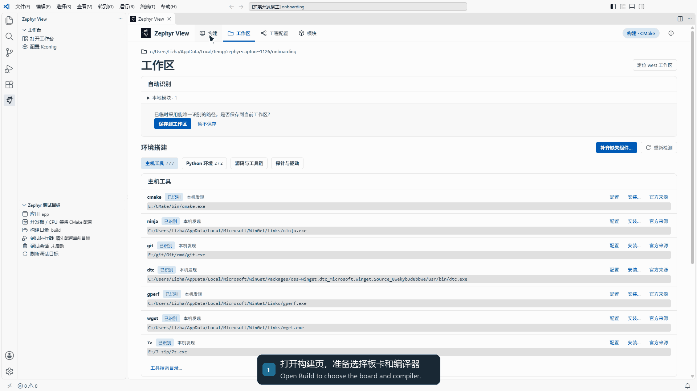
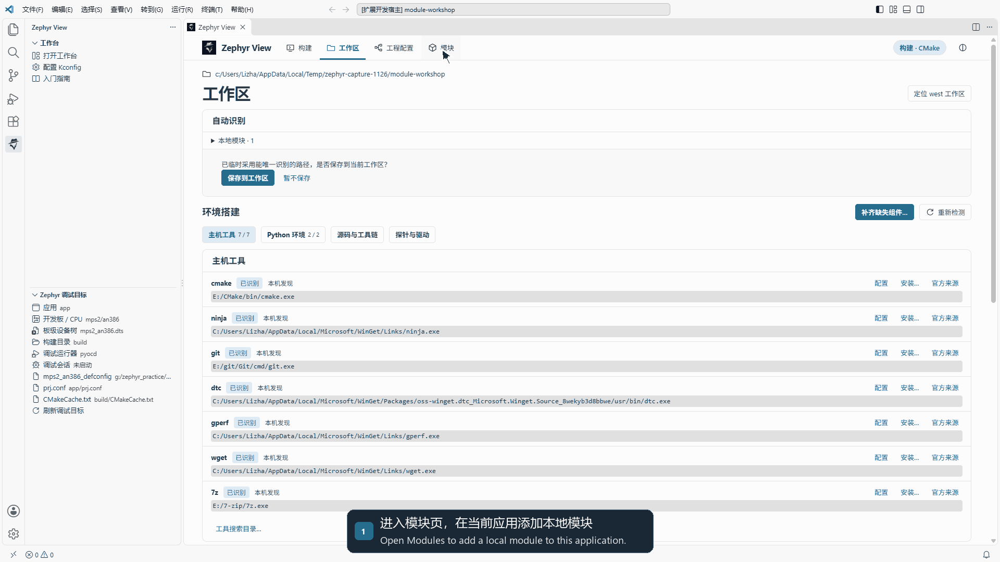

# 用 CMake 接入编译器和本地模块

**简体中文** | [English](cmake-integration.en.md)

这次做一个能在 QEMU 上运行的 Cortex-M4 应用。先让它打印 `Application only`，再加入一个本地库，让同一个应用打印 `Hello from the local module`。你可以在 Zephyr View 中操作，也可以用下面的命令在终端复现。

## 准备一份自己的工程

在命令面板运行 **Zephyr View: 复制入门示例…**，选择可写目录，然后在新窗口打开复制出的 `zephyr-view-examples` 文件夹。在其终端运行 `cd onboarding`。也可从源码复制整个 [onboarding 示例目录](../examples/onboarding)，从该目录开始操作。示例分为两部分。

- [app](../examples/onboarding/app) 是应用。`find_package(Zephyr REQUIRED HINTS $ENV{ZEPHYR_BASE})` 加载所选 Zephyr 源码提供的构建系统，`target_sources(app PRIVATE src/main.c)` 把入口文件交给应用目标。
- [modules/greeting](../examples/onboarding/modules/greeting) 是独立模块，内有 `zephyr/module.yml`、`Kconfig` 和 `CMakeLists.txt`。复制到别处后，选择它的新目录即可。

在「工作区 → 环境搭建」检查 CMake、Ninja、已安装 Zephyr 构建依赖的 Python、Zephyr 源码和适用于宿主机的 SDK。使用模拟器还需要 QEMU 的 ARM 系统模拟器。本例目标为 `mps2/an386`。使用 Zephyr 4.5.0-rc1 完全离线构建该目标时，还需要与这份 Zephyr 清单版本匹配的 `cmsis_6` 源码。其他目标和版本按各自清单准备依赖。[Zephyr 应用与工具要求](https://docs.zephyrproject.org/latest/develop/application/index.html) · [Zephyr SDK](https://docs.zephyrproject.org/latest/develop/toolchains/zephyr_sdk.html)

## 在工作台选目标、编译器与编译选项

1. 进入「构建」，选择 **CMake** 或 **west**，应用目录选 `app`，在开发板列表搜索并选中 `mps2/an386`。给本次配置一个新的构建目录，例如 `build/sdk-off`。
2. 查看「目标编译器」。SDK 已安装 ARM GNU 工具链时，这个目标的推荐编译器是 `arm-zephyr-eabi-gcc`。使用自动推荐，或选择其他外部 GNU 编译器并应用。换编译器时使用另一构建目录，例如 `build/external-on`。
3. 到「模块」，选择本地目录 `modules/greeting` 并勾选它。使用 west 构建时，已有清单模块会保留。选择 CMake 也一样，只要构建所用的 Python 已安装 west，且从 `ZEPHYR_BASE` 能找到对应的 west 工作区，Zephyr 仍会自动发现清单模块。完全离线时，如果既没有发现清单模块，工程也没有提供主模块列表，就要选全这块板需要的本地模块。本例还需勾选 `cmsis_6`。
4. 点击「配置」，查看构建记录中的 `CMAKE_C_COMPILER` 和板目标，再点击「构建」。默认只加载 `prj.conf`，此时得到打印 `Application only` 的第一个固件。并行任务数选「自动」即可，也可指定如 4，表示最多同时运行四个主机编译任务。
5. 打开「工程配置」的 Kconfig 分支，搜索 `ONBOARDING_GREETING`，启用并核对草稿，再保存到应用配置。也可以保持 `prj.conf` 原样，在构建的附加 CMake 参数中填写一行 `EXTRA_CONF_FILE=enable-greeting.conf`，使用样例随附的片段。重新「配置 → 构建」。开启后，启动固件会打印模块的问候语。

**选编译器并检查生成配置**



**将本地模块加入当前构建**



## 哪个文件决定了结果？

| 输入 | Zephyr / CMake 如何使用 | 如何确认 |
| --- | --- | --- |
| `BOARD=mps2/an386` 与工具链变体 | 板和 SoC 提供 Cortex-M4 架构信息；工具链变体负责查找编译器、链接器和配套工具 | 在构建目录打开 `CMakeCache.txt`，搜索 `CMAKE_C_COMPILER`；在 `compile_commands.json` 找到 `main.c` 的 `-mcpu=cortex-m4` |
| [zephyr/module.yml](../examples/onboarding/modules/greeting/zephyr/module.yml) | `name` 标识模块，`build.cmake: .` 指向模块根目录，`build.kconfig: Kconfig` 注册定义文件。两个路径均相对于模块根 | 在构建目录的 `zephyr_modules.txt` 搜索 `onboarding_greeting` 和目录 |
| [Kconfig](../examples/onboarding/modules/greeting/Kconfig) 与 [enable-greeting.conf](../examples/onboarding/app/enable-greeting.conf) | 定义一个默认为关闭的布尔符号；应用片段将 `CONFIG_ONBOARDING_GREETING` 设为 `y` | 在 `zephyr/.config` 找 `CONFIG_ONBOARDING_GREETING=y` 或 `# CONFIG_ONBOARDING_GREETING is not set` |
| [模块 CMakeLists.txt](../examples/onboarding/modules/greeting/CMakeLists.txt) 与 [应用入口](../examples/onboarding/app/src/main.c) | 符号为真时导出公共头文件目录、建立 Zephyr 库并编译 `src/greeting.c`；应用使用同一符号调用库函数 | 只有开启时，`compile_commands.json` 才列出 `greeting.c`，生成的 `zephyr/zephyr.elf` 打印模块消息 |

迁移自己的库时，先用 `module.yml` 告诉 Zephyr 库的 CMake 和 Kconfig 在哪里，再把实际源文件交给 `zephyr_library_sources()`。在 `.conf` 中使用 `CONFIG_` 前缀，在定义符号的 `Kconfig` 中使用不带前缀的名字。要给库加专用编译选项，可在 `zephyr_library()` 后用 `zephyr_library_compile_options(...)`，这样选项只作用于这个库。[模块接入规范](https://docs.zephyrproject.org/latest/develop/modules.html) · [Kconfig 配置合并规则](https://docs.zephyrproject.org/latest/build/kconfig/setting.html)

## 用命令复现

先激活 Zephyr 的 Python 环境，让当前终端能找到 CMake 和 Ninja。`ZEPHYR_BASE` 指向含有 `VERSION` 和 `share/zephyr-package` 的 Zephyr 源码根。未注册的 SDK 可通过环境变量 `ZEPHYR_SDK_INSTALL_DIR` 指向 SDK 根目录。工作台中为任务设置的环境值若没有在终端生效，在终端单独设置。下列变量先从示例副本取得绝对路径，以便切换目录后仍然有效。

**PowerShell**

```powershell
$lab = (Get-Location).Path
$greeting = (Resolve-Path ./modules/greeting).Path.Replace('\', '/')
```

**Bash / zsh**

```sh
lab="$PWD"
greeting="$lab/modules/greeting"
```

**路线 A · 已有 west 工作区。** 在同一终端切换到已初始化的 west 工作区，再运行：

```sh
west build -b mps2/an386 -d "$lab/build/west-on" "$lab/app" -- "-DEXTRA_ZEPHYR_MODULES=$greeting" -DEXTRA_CONF_FILE=enable-greeting.conf
```

`--` 之前是 west 的参数，之后传给 CMake。`EXTRA_ZEPHYR_MODULES` 把本地模块追加到清单发现的模块上。构建后可以执行 `west build -d "$lab/build/west-on" -t run` 启动 QEMU，再用 `Ctrl+A`、`X` 退出。[west 构建选项](https://docs.zephyrproject.org/latest/develop/west/build-flash-debug.html)

**路线 B · 独立 CMake，使用 SDK。** 切回示例副本。获取本机 `cmsis_6` **模块根目录**，里面应有 `zephyr/module.yml`；填写真实路径，可从资源管理器复制。完全离线时，`ZEPHYR_MODULES` 需要包含所选板和应用的全部所需模块。

```powershell
$cmsis = (Resolve-Path (Read-Host 'cmsis_6')).Path.Replace('\', '/')
```

```sh
# Bash / zsh
printf 'cmsis_6: '; IFS= read -r cmsis
```

下列命令适用于两种终端。引号让分号分隔的两个路径作为一个 CMake 参数传入：

```sh
cmake -S app -B build/sdk-off -G Ninja -DBOARD=mps2/an386 -DZEPHYR_TOOLCHAIN_VARIANT=zephyr "-DZEPHYR_MODULES=$cmsis;$greeting"
cmake --build build/sdk-off --parallel 4
cmake --build build/sdk-off --target run
```

先观察 `Application only`。退出模拟器后，开启功能并重复构建：

```sh
cmake -S app -B build/sdk-off -DEXTRA_CONF_FILE=enable-greeting.conf
cmake --build build/sdk-off --parallel 4
cmake --build build/sdk-off --target run
```

恢复关闭可运行 `cmake -S app -B build/sdk-off -DEXTRA_CONF_FILE=` 后再次构建。要复现首次配置，用一个新的构建目录。[不使用 west 提供模块](https://docs.zephyrproject.org/latest/develop/modules.html#without-west)

**选择调试优化。** 示例的 [debug.conf](../examples/onboarding/app/debug.conf) 启用了 `CONFIG_DEBUG_OPTIMIZATIONS`。要同时使用模块与调试优化，在构建页「附加 CMake 参数」填 `EXTRA_CONF_FILE=enable-greeting.conf;debug.conf`；或在路线 B 成功后运行下面两行。在 `compile_commands.json` 找到 `greeting.c` 的编译命令，本例 GNU 工具链生成了 `-Og`。构建任务数控制并发，优化选项控制生成的机器码。

```sh
cmake -S app -B build/sdk-off "-DEXTRA_CONF_FILE=enable-greeting.conf;debug.conf"
cmake --build build/sdk-off --parallel 4
```

**路线 C · 给 CMake 换外部 GNU 交叉编译器。** 安装与宿主机匹配、支持 Cortex-M4 的 Arm GNU 裸机工具链，在当前终端确认 `arm-none-eabi-gcc --version` 可用。以下命令从真实可执行文件取得带结尾连字符的工具前缀：

```powershell
$gcc = (Get-Command arm-none-eabi-gcc).Source
$prefix = ($gcc -replace 'gcc(\.exe)?$', '').Replace('\', '/')
```

```sh
# Bash / zsh
gcc_path=$(command -v arm-none-eabi-gcc)
prefix=${gcc_path%gcc}
```

```sh
cmake -S app -B build/external-on -G Ninja -DBOARD=mps2/an386 -DZEPHYR_TOOLCHAIN_VARIANT=cross-compile "-DCROSS_COMPILE=$prefix" "-DZEPHYR_MODULES=$cmsis;$greeting" -DEXTRA_CONF_FILE=enable-greeting.conf
cmake --build build/external-on --parallel 4
```

`CROSS_COMPILE` 形如 `…/bin/arm-none-eabi-`。Zephyr 用这个前缀找到 gcc、ld 和 objcopy 等工具，`CMAKE_C_COMPILER` 记录最终选用的可执行文件。只有 gcc 而缺少工具链的其他部分，可能在链接或生成镜像时失败。[Zephyr 外部交叉编译器接口](https://docs.zephyrproject.org/latest/develop/toolchains/other_x_compilers.html)

## 已验证的结果与排查

在 Windows 11、Zephyr 4.5.0-rc1、`mps2/an386` 上，以下三个构建都生成了 ELF，并在 QEMU 的串口看到了预期消息。两条独立 CMake 路线使用没有安装 west 的 Python 环境。

| 构建方式 | CMake 记录的编译器 | `greeting.c` 编译单元 | QEMU 启动输出 |
| --- | --- | --- | --- |
| west + Zephyr SDK 1.0.1，开启 | `arm-zephyr-eabi-gcc` | 1 | `Hello from the local module` |
| CMake + Zephyr SDK 1.0.1，关闭 | `arm-zephyr-eabi-gcc` | 0 | `Application only` |
| CMake + 外部 Arm GNU 10.3.1，开启 | `arm-none-eabi-gcc` | 1 | `Hello from the local module` |

若出现未定义的 Kconfig 符号，先在 `zephyr_modules.txt` 找模块，再检查 `module.yml` 的 Kconfig 路径。若配置成功但功能没打开，检查 `.config` 的实际值和合并片段的顺序。若 Windows 上的上述 Zephyr 版本报 `-imacros` 或含空格的路径被拆为多个输入文件，可在路径无空格的新构建目录重试；本次使用同一套源码在新目录完成了构建。

要把同一个应用移植到自己的板卡，见[新增开发板与 SoC](hardware-port.md)。

**简体中文** | [English](cmake-integration.en.md)
