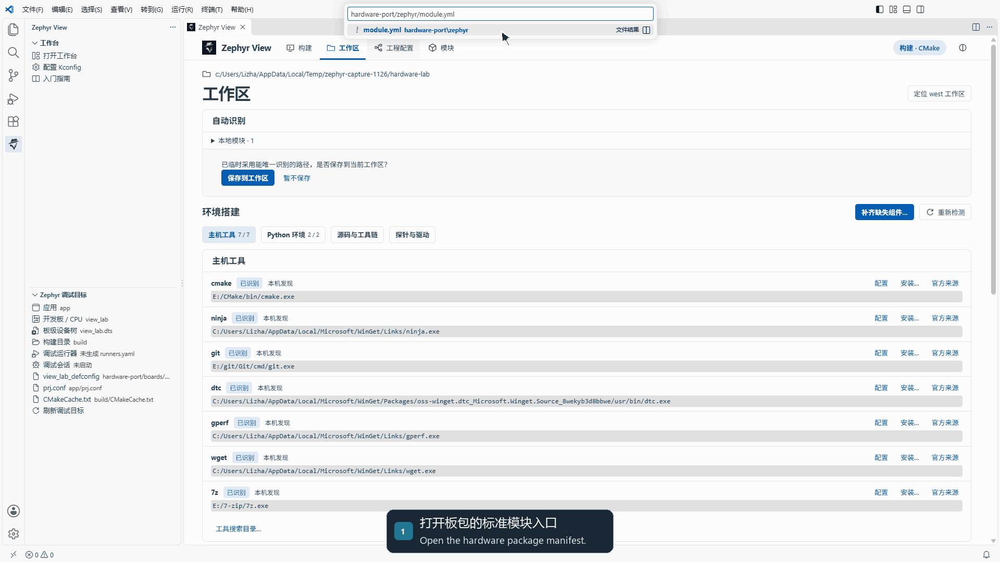

# Bring a board and SoC into Zephyr

[简体中文](hardware-port.md) | **English**

First identify which part you are adding. Two boards can share one SoC. Clocks, pin routing, memory wiring and connected peripherals belong to the board design. If Zephyr supports your SoC, reference its name in the new board's `board.yml`. For a new SoC, also provide its hardware description and architecture configuration. [Board porting guide](https://docs.zephyrproject.org/latest/hardware/porting/board_porting.html) · [SoC porting guide](https://docs.zephyrproject.org/latest/hardware/porting/soc_porting.html)

## Import a hardware package you can build

1. Run **Zephyr View: Copy Tutorial Examples…** from the VS Code Command Palette. Choose a writable location and open the resulting `zephyr-view-examples` folder. On **Build**, select `onboarding/app` and choose west or CMake.
2. Under **Modules → Available modules → Select directory**, choose [hardware-port](../examples/hardware-port). Check that its name resolves to `view_hardware` and include it in the build. For a standalone CMake build with an explicit module list, also provide the Cortex-M core support modules required by your Zephyr version. The tested Zephyr 4.5.0-rc1 checkout uses `cmsis_6`.
3. Return to **Build → Board and CPU**, search for `view_lab` and choose **view_lab/view_m3**. Select a fresh build directory such as `build/view-lab`, choose **Configure**, then **Build**.
4. Inspect `zephyr/.config`, `zephyr/zephyr.dts` and `zephyr/zephyr.elf` in that directory. The first two contain the resolved software configuration and hardware description. The ELF is the linked firmware.



## Trace a board selection through its files

| Open this example file | What it controls |
| --- | --- |
| [zephyr/module.yml](../examples/hardware-port/zephyr/module.yml) | Three `build.settings` entries export `board_root`, `soc_root` and `dts_root` from the module root. Select the directory containing this metadata. |
| [board.yml](../examples/hardware-port/boards/vnd/view_lab/board.yml) and [Kconfig.view_lab](../examples/hardware-port/boards/vnd/view_lab/Kconfig.view_lab) | The former names the board and its supported SoC. The latter selects `SOC_VIEW_M3` in Kconfig when this board is selected. |
| [soc.yml](../examples/hardware-port/soc/vnd/view_m3/soc.yml), [Kconfig.soc](../examples/hardware-port/soc/vnd/view_m3/Kconfig.soc) and [Kconfig](../examples/hardware-port/soc/vnd/view_m3/Kconfig) | Register the SoC name and symbol and map it to ARM Cortex-M3. The board references the SoC name. Its CPU architecture determines the compiler target. |
| [view-m3.dtsi](../examples/hardware-port/dts/arm/vnd/view-m3.dtsi) and [view_lab.dts](../examples/hardware-port/boards/vnd/view_lab/view_lab.dts) | The SoC describes the CPU, memory and interrupt controller. The board includes that description and selects Flash and SRAM in `chosen`. Zephyr selects the base DTS from the board target. This application can build without an overlay. |
| [SoC CMakeLists.txt](../examples/hardware-port/soc/vnd/view_m3/CMakeLists.txt) and [board defconfig](../examples/hardware-port/boards/vnd/view_lab/view_lab_defconfig) | The former supplies the headers and Cortex-M linker script. The latter sets board defaults. The application can still use `prj.conf` to set options whose dependencies are satisfied. |

This configuration, compilation and linking exercise uses Zephyr hardware model v2. The example describes 256 KiB of Flash, 64 KiB of SRAM and a 12 MHz clock. It defines no serial port or flash runner. For physical hardware, use the chip data sheet and board schematic to set the actual addresses, clocks, interrupts, pins and peripherals, then configure a runner for your probe and validate on the board.

## Reproduce the build in a terminal

Start in the copied `zephyr-view-examples` folder. Activate Python with the Zephyr dependencies installed and configure `ZEPHYR_BASE` and your SDK. These commands assume the environment can already resolve the base modules for a Cortex-M build. For an offline build without west, follow the [standalone CMake module example](cmake-integration.en.md) and add the hardware package to the same explicit module list.

**PowerShell**

```powershell
$hardware = (Resolve-Path hardware-port).Path
cmake -S onboarding/app -B build/view-lab -G Ninja -DBOARD=view_lab/view_m3 "-DEXTRA_ZEPHYR_MODULES=$hardware"
cmake --build build/view-lab --parallel
```

**Bash**

```bash
hardware="$(cd hardware-port && pwd)"
cmake -S onboarding/app -B build/view-lab -G Ninja -DBOARD=view_lab/view_m3 "-DEXTRA_ZEPHYR_MODULES=$hardware"
cmake --build build/view-lab --parallel
```

If your application owns the hardware directory, you can declare the roots **before** `find_package(Zephyr)` in the application’s `CMakeLists.txt`. The paths below are for the copied `onboarding/app`. Use this method or the module import shown above.

```cmake
set(hardware_dir "${CMAKE_CURRENT_LIST_DIR}/../../hardware-port")
list(APPEND BOARD_ROOT "${hardware_dir}")
list(APPEND SOC_ROOT   "${hardware_dir}")
list(APPEND DTS_ROOT   "${hardware_dir}")
```

## Make a change and check the result

Create `app.overlay` in your application and enter `/ { model = "My View Lab prototype"; };`. Configure in a fresh build directory and search for the new name in `zephyr/zephyr.dts`. Then check `zephyr/.config` for `CONFIG_BOARD="view_lab"`, `CONFIG_SOC="view_m3"` and `CONFIG_CPU_CORTEX_M3=y`. This checks the devicetree change and the board and architecture selection independently. When using multiple overlays, inspect the active files and their order on the Build page.

If the board is missing, check the module selection for the **current build method** and look for `boards/` in the hardware root. If the board is found but the SoC is unknown, check `socs[].name` in `board.yml`, the SoC's `soc.yml` and `soc_root`. If the preprocessor cannot find a `.dtsi`, check `dts_root` and the include path. Inspect the generated `.config` and `zephyr.dts` for results, then make persistent changes in the project sources.

[Back to Getting Started](../GETTING_STARTED.en.md)

[简体中文](hardware-port.md) | **English**
