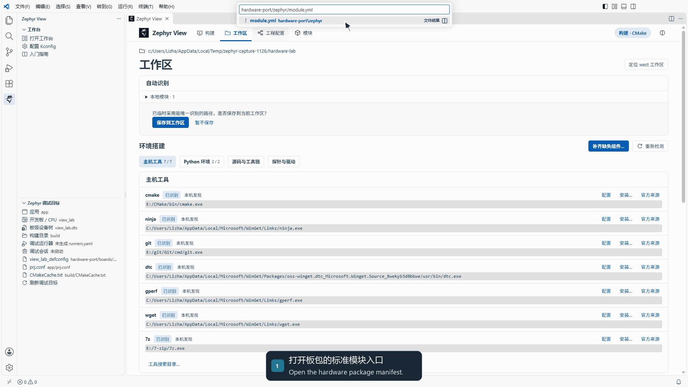

# 把自己的板和 SoC 接入 Zephyr

**简体中文** | [English](hardware-port.en.md)

先判断要新增的是哪一层。两块板可以共用一颗 SoC；同一块板上的时钟、引脚、存储器布线和已连接外设则由板级描述决定。如果 Zephyr 已支持你的 SoC，可以直接在板的 `board.yml` 中引用其名称。只有要引入新的 SoC 时，才需要增加 SoC 的硬件描述和架构配置。[官方板级移植指南](https://docs.zephyrproject.org/latest/hardware/porting/board_porting.html) · [官方 SoC 移植指南](https://docs.zephyrproject.org/latest/hardware/porting/soc_porting.html)

## 导入一个可以编译的硬件包

1. 从 VS Code 命令面板运行 **Zephyr View: 复制入门示例…**，选择可写目录，打开生成的 `zephyr-view-examples`。进入「构建」选择 `onboarding/app`，先确定使用 west 或 CMake。
2. 在「模块 → 待选模块 → 选择目录」中选择 [hardware-port](../examples/hardware-port)。核对识别到的名字 `view_hardware`，将它加入当前构建。使用独立 CMake 的显式模块清单时，一并提供所用版本要求的 Cortex-M 核心支持模块。下文实测的 Zephyr 4.5.0-rc1 使用 `cmsis_6`。
3. 回到「构建 → 开发板与 CPU」，搜索 `view_lab`，选中完整目标 **view_lab/view_m3**。选择新构建目录，例如 `build/view-lab`，点击「配置」，完成后点击「构建」。
4. 查看构建目录中的 `zephyr/.config`、`zephyr/zephyr.dts` 和 `zephyr/zephyr.elf`。前两项分别记录软件配置和硬件描述，最后一项是链接后的固件。



## 从文件追踪一次选板

| 打开示例中的文件 | 它在构建中决定什么 |
| --- | --- |
| [zephyr/module.yml](../examples/hardware-port/zephyr/module.yml) | 三个 `build.settings` 项从模块根导出 `board_root`、`soc_root`、`dts_root`。只需选择包含这份描述的模块根目录。 |
| [board.yml](../examples/hardware-port/boards/vnd/view_lab/board.yml) 与 [Kconfig.view_lab](../examples/hardware-port/boards/vnd/view_lab/Kconfig.view_lab) | 前者声明板名及它支持的 SoC；后者使选中该板的 Kconfig 构建选择 `SOC_VIEW_M3`。 |
| [soc.yml](../examples/hardware-port/soc/vnd/view_m3/soc.yml)、[Kconfig.soc](../examples/hardware-port/soc/vnd/view_m3/Kconfig.soc) 与 [Kconfig](../examples/hardware-port/soc/vnd/view_m3/Kconfig) | 注册 SoC 名称和配置符号，将这个 SoC 映射到 ARM Cortex-M3。与板名相连的是 SoC 名，与编译器目标相连的是 CPU 架构。 |
| [view-m3.dtsi](../examples/hardware-port/dts/arm/vnd/view-m3.dtsi) 与 [view_lab.dts](../examples/hardware-port/boards/vnd/view_lab/view_lab.dts) | SoC 描述 CPU、内存及中断控制器。板级 DTS 包含它并用 `chosen` 选出 Flash、SRAM。Zephyr 根据板目标选择基础 DTS；本例的应用可以不提供 overlay。 |
| [SoC 的 CMakeLists.txt](../examples/hardware-port/soc/vnd/view_m3/CMakeLists.txt) 与 [板级 defconfig](../examples/hardware-port/boards/vnd/view_lab/view_lab_defconfig) | 前者接入头文件和 Cortex-M 链接脚本；后者提供板的默认配置。应用仍可通过 `prj.conf` 设置依赖允许的选项。 |

这个练习使用 Zephyr 的硬件模型 v2，用于学习配置、编译和链接。示例约定 256 KiB Flash、64 KiB SRAM 和 12 MHz 时钟，未定义串口或烧写运行器。移植实物时应按芯片手册和板卡原理图更改地址、时钟、中断、引脚和外设，再按探针选择运行器并上板验证。

## 在终端复现

从复制出的 `zephyr-view-examples` 开始。先激活含 Zephyr 依赖的 Python 环境，配置 `ZEPHYR_BASE` 和 SDK。下面假定当前环境已能为 Cortex-M 项目找到所需的基础模块。全离线、没有 west 时可按[独立 CMake 模块示例](cmake-integration.md)显式提供模块列表，把本例的硬件包加入同一列表。

**PowerShell**

```powershell
$hardware = (Resolve-Path hardware-port).Path
cmake -S onboarding/app -B build/view-lab -G Ninja -DBOARD=view_lab/view_m3 "-DEXTRA_ZEPHYR_MODULES=$hardware"
cmake --build build/view-lab --parallel
```

**Bash**

```bash
hardware="$(cd hardware-port && pwd)"
cmake -S onboarding/app -B build/view-lab -G Ninja -DBOARD=view_lab/view_m3 "-DEXTRA_ZEPHYR_MODULES=$hardware"
cmake --build build/view-lab --parallel
```

如果硬件目录本身由你的应用维护，也可以在应用的 `CMakeLists.txt` 中、`find_package(Zephyr)` **之前**声明各根。下例适用于副本中的 `onboarding/app`，这种方式与上面的模块导入任选其一。

```cmake
set(hardware_dir "${CMAKE_CURRENT_LIST_DIR}/../../hardware-port")
list(APPEND BOARD_ROOT "${hardware_dir}")
list(APPEND SOC_ROOT   "${hardware_dir}")
list(APPEND DTS_ROOT   "${hardware_dir}")
```

## 做一个小改动，确认它真的生效

在应用目录建立 `app.overlay`，写入 `/ { model = "My View Lab prototype"; };`。用新构建目录重新配置，打开 `zephyr/zephyr.dts` 搜索新名称。再打开 `zephyr/.config`，应能读到 `CONFIG_BOARD="view_lab"`、`CONFIG_SOC="view_m3"` 和 `CONFIG_CPU_CORTEX_M3=y`。这样能分别验证修改进了设备树、板和架构仍由原来的选择决定。已有多个 overlay 时，在构建页核对启用的文件和顺序。

若找不到板，先看模块是否参与**当前构建方式**以及根目录下是否有 `boards/`。若能找到板却报告未知 SoC，核对 `board.yml` 的 `socs[].name`、`soc.yml` 及 `soc_root`。若预处理找不到 `.dtsi`，核对 `dts_root` 与 include 路径。构建生成的 `.config` 和 `zephyr.dts` 适合核对结果，持久修改应写入工程源文件。

[回到入门指南](../GETTING_STARTED.md)

**简体中文** | [English](hardware-port.en.md)
