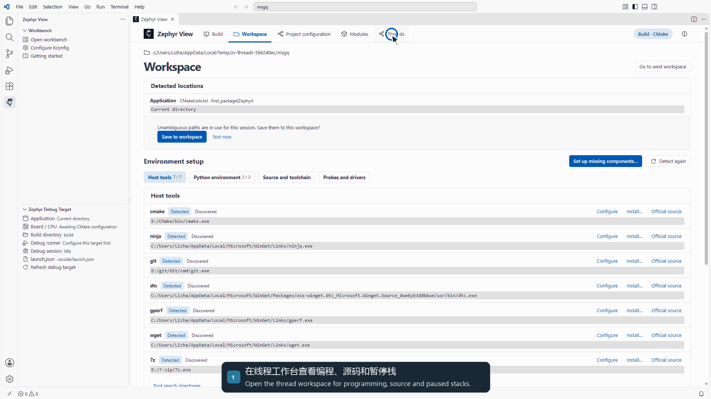

# Follow a value between two threads

[简体中文](threads.md) | **English**

Open **Zephyr View → Programming Studio → Tools → Analyze project concurrency → Program draft**. Start with **Message queue** to see who receives a sample produced by another thread. Try the design offline, then build the generated application with west or CMake.

## Choose what crosses the thread boundary

| What you need | Component | What to observe |
| --- | --- | --- |
| Send a value for another thread to consume | Message queue | The producer sends a `uint32_t`; the consumer receives a copy. The example prints `received 42`. |
| Wait until another thread is ready | Semaphore | The count starts at zero. One give allows one take. The example prints `permit acquired`. |
| Let two threads update the same counter | Mutex | Both workers protect the increment with the same lock. Look for 1 and 2 in the output. Scheduling determines lock acquisition order. |

Select a thread on the diagram to change its stack size and priority. Select the queue to edit its capacity. Change 4 to 8 and find the third argument of `K_MSGQ_DEFINE` under **Generated project files → src/main.c**. Switch to **Create at run time** and find both `k_thread_create()` calls in `main()`. The stack and thread control block have static storage duration. Their storage exists before the thread is submitted to the scheduler. The example enables eight preemptible priority levels in `prj.conf`.

## Build and check the source

1. Select **Export sample project** and choose a parent folder in the system dialog. The extension creates a new child such as `zephyr-threads-msgq`. Select **Open in New Window**. If a project with the same name exists, choose another parent.
2. In **Build**, choose the exported application, a board and a build method. If your SDK includes QEMU, try `mps2/an386`. Configure and build. For an emulated target, run `cmake --build . --target run` in the build directory. In a west workspace, you can also run `west build -d <build-directory> -t run`.
3. Open **Source analysis → Analyze application**, select `consumer_entry`, and inspect the arguments of `k_msgq_get(&samples, &value, K_FOREVER)`. Click the filename and line to open the source. Select the producer to find the write to the same `samples` queue.
4. Check whether the view lists translation units from the compilation database or candidates found under the application directory. For conditional candidates, check this target's Kconfig, compilation flags and preprocessed output. Analyze again after moving or modifying a source file.

## Check the received value in the debugger

Set a breakpoint on the consumer's successful `printk` after the receive. Start a VS Code debug configuration for this firmware, for example with Cortex-Debug. When the target stops, open **Paused stack → Read threads**. Choose the execution context, frame and local scope. Look for `consumer_entry` and `value = 42`. Optimization can remove some variables from the debugger's view.

An adapter may report just `CPU#0`, identifying one CPU execution context. The adapter and its RTOS support determine the names and number of contexts. Resuming discards frames and values from that stop. Read the new context when execution pauses again.

[Zephyr threads and stacks](https://docs.zephyrproject.org/latest/kernel/services/threads/index.html) · [Message queues](https://docs.zephyrproject.org/latest/kernel/services/data_passing/message_queues.html) · [Back to Getting started](../GETTING_STARTED.en.md)

[简体中文](threads.md) | **English**
