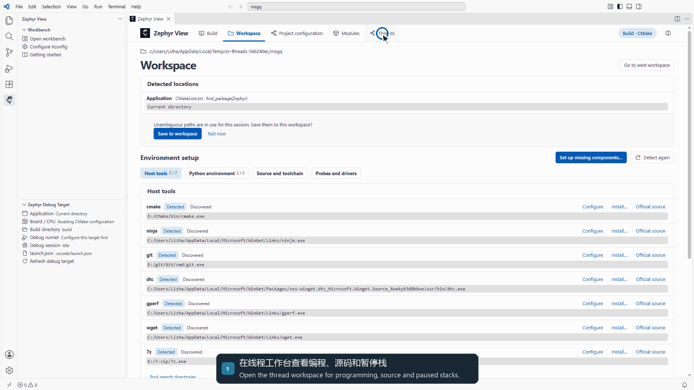

# 用两个线程完成第一次消息交接

**简体中文** | [English](threads.en.md)

打开 Zephyr View 的 **线程 → 编程草稿**。如果你想知道采样线程产生的一个数最终交给了谁，可以从「消息队列」开始。设计草稿可以先离线试，生成的工程再用工作台现有的 west 或 CMake 构建。

## 先选两个线程之间传递什么

| 要解决的问题 | 选哪一项 | 运行时观察什么 |
| --- | --- | --- |
| 一个线程发送数值，另一个线程取走它 | 消息队列 | 生产者把 `uint32_t` 写入队列，消费者拿到自己的副本。示例打印 `received 42`。 |
| 一个线程完成准备，另一个线程才继续 | 信号量 | 初始计数为零，一次 give 允许一次 take。示例打印 `permit acquired`。 |
| 两个线程都会修改同一个计数器 | 互斥量 | 两个工作线程用同一把锁保护自增。输出包含 1 和 2；线程取得锁的次序由调度决定。 |

点击图上的线程选栈大小和优先级，点击队列选可容纳的消息数。试着把容量从 4 改成 8，在 **生成的工程文件 → src/main.c** 找到 `K_MSGQ_DEFINE` 的第三个参数。把创建方式切到 **运行时创建**，再找到 `main()` 中的两次 `k_thread_create()`。栈和线程控制块具有静态存储期，适合观察“内存何时分配”和“何时交给调度器”这两件事。示例在 `prj.conf` 中启用八级可抢占优先级。

## 构建，再核对源码

1. 点击 **导出示例工程**，在系统对话框里选择父目录。扩展会新建一个子目录，例如 `zephyr-threads-msgq`。选 **在新窗口打开**，已有同名工程时可换一个父目录。
2. 打开 **构建**，选择导出的应用、可用的板和构建方式。使用带 QEMU 的 SDK 时可以选 `mps2/an386`。配置并构建后，模拟器目标可在该工程的构建目录运行 `cmake --build . --target run`。在 west 工作区也可运行 `west build -d <构建目录> -t run`。
3. 打开 **线程 → 工程分析 → 分析当前应用**，选择 `consumer_entry`，对照 `k_msgq_get(&samples, &value, K_FOREVER)` 的三个实参。点击文件名和行号跳回源文件。换到生产者即可找到对同一个 `samples` 的写入。
4. 页面会标明文件来自编译数据库还是应用目录扫描。看到“条件编译候选”时，结合该目标的 Kconfig、编译参数和预处理结果再判断。修改或移动源文件后重新扫描。

## 用调试器核实收到的数值

在消费者成功取数后的 `printk` 行设断点。启动与本次固件匹配的 VS Code 调试配置，可以使用 Cortex-Debug。目标暂停后打开 **线程 → 暂停栈 → 读取线程**，依次选执行上下文、栈帧和局部变量。消息队列练习中这里应能看到 `consumer_entry` 和 `value = 42`。优化可能导致部分变量不可见。

同一目标可能只报告 `CPU#0`，这表示调试器枚举到的 CPU 上下文。上下文的名称和数量取决于适配器及 RTOS 支持。继续运行会清空这次暂停的帧和值；下次暂停需要重新读取。

[Zephyr 线程与栈](https://docs.zephyrproject.org/latest/kernel/services/threads/index.html) · [消息队列](https://docs.zephyrproject.org/latest/kernel/services/data_passing/message_queues.html) · [返回入门指南](../GETTING_STARTED.md)

**简体中文** | [English](threads.en.md)
