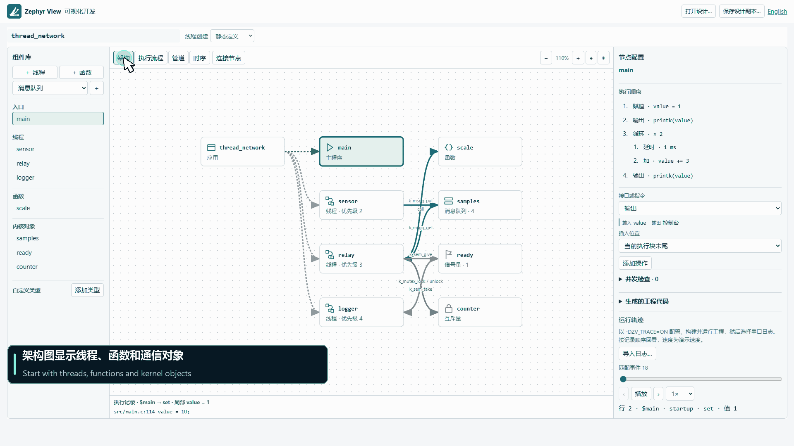
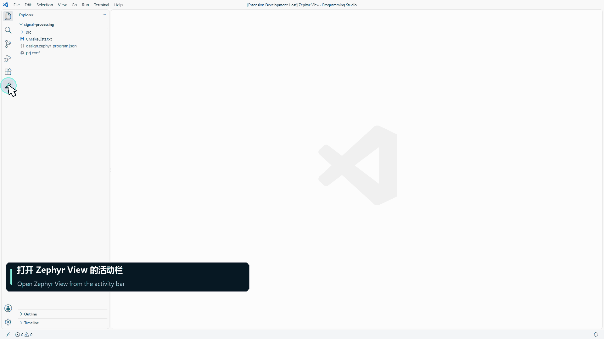

# Follow a message through a visual program

[简体中文](visual-program.md) | **English**

Open **Zephyr View → Open Programming Studio** from the Activity Bar. In the separate window choose **File → Play firmware example** to open a separate design document with its matching QEMU recording. Both ship with the extension and work offline. To start your own program, choose **New design** and add instructions at the `main` entry point.


## Follow the signal

1. Select `sensor` on the left and inspect **Architecture**. An arrow goes from the sending thread to the `samples` message queue. A second arrow goes from the queue to the receiving thread `relay`. Select a connection to inspect its operation.
2. Pause **Playback** in the right dock and step through the records. Find **42** at the `publish` send and **42** again at the `read` receive. Inside `scale`, the condition succeeds and `double` produces **84**. Follow the highlighted C line in **Generated source**.
3. Switch to **Control flow** and select `scale`. Both outcomes of the condition appear in the design. The recording highlights the branch taken on this run. The `ready` semaphore passes a permit. A value shown at give or take belongs to that thread. The `counter` mutex protects a shared counter update.

Select an entry point, thread, function or kernel object in the library on the left. Drag the canvas background to pan or use Ctrl + wheel to zoom. If a node has moved out of sight, use the canvas toolbar to locate the selection or fit the diagram. Edit instruction order and arguments under **Properties** on the right.

## Trace a pipeline, a sequence and a control-flow branch

Choose **Play firmware example** and switch to **Pipeline**. Follow `sensor → samples → relay` from the producer through the queue to the consumer. Select an endpoint to locate its operation. To investigate a particular value, switch to **Sequence** and select the call to `scale` or its return. The firmware recorded an input of `42` and an output of `84`. Vertical order follows the capture. Measuring elapsed time requires timestamps. Switch to **Control flow** to inspect both exits of the corresponding condition.



## Work with the design, project source and debugger in one window

1. Move the studio to another monitor or maximize it. Opening the same design again brings its window forward. Select a condition, function or queue operation on the left to highlight its line in **Generated source** on the right. Drag the divider to make space for long lines. The dock below the source switches between properties, checks and playback.
2. For existing firmware, switch to **Project source**. The studio looks for an open C/C++ file in this workspace or the application's `src/main.c`. Use **Choose file…** to search the project or browse the disk. Expand a struct, union or bit-field and select a member to locate its declaration on the right. Use **Edit source** to change the file in the native editor. The studio follows unsaved changes.
3. Select an executable line and choose **Toggle breakpoint**. Use **Start debugging** to launch a project debug configuration. When paused, continue, step over, step into or out, or reveal the stack frame. If several sessions are running, select the session you want to control. Projects using Cortex-Debug can reuse their installed adapter, probe and launch configuration.
4. Calls and signals in the source view come from the current file. An unfinished delimiter retains the last valid diagram until source navigation can resume. Check cross-file macro expansion, indirect call targets and runtime values against the actual build or debug session.



## Define a flag type and check a high bit

Choose **New design → Enums and bit flags**. The type library defines `Status.ready = 1` and `Status.alarm = 2147483648`. Replay the included firmware capture. Bitwise OR produces `2147483649`, masking with `alarm` produces `2147483648`, and shifting right by 31 yields `1`.

Create an enum in the type library, add its members, and choose the type and member under **Operand type** in the instruction properties. The members hold unsigned 32-bit values for use in calculations and conditions. References follow a rename. Reassign instructions that use a member before deleting it.

## Edit source with the diagram beside it

Open an application’s `.c` or `.h` file and use the preview icon in the editor title or choose **Live C source diagram** from the Command Palette. In the source editor, change `k_sem_take(&ready, K_FOREVER)` to `k_sem_give(&ready)`. The signal arrow changes direction as you type. Switch views to inspect calls, thread entries or type declarations in the current file. Expand a struct, union or enum to see its members and follow source locations back to the definition. While a delimiter is incomplete, the preview retains the previous valid diagram and explains why. Use the firmware sequence to check which operations actually ran.

For a visual design, choose **Edit JSON beside** to open its `.zephyr-program.json` text. Both editors share the document and undo history. While a JSON edit is incomplete, the last valid diagram stays visible with canvas editing suspended. Completing the edit restores the canvas.


## Exercise: move an operation to another branch

1. **Save as** a copy of the firmware example. Open **Control flow** and select the `double` step in `scale`. Expand **Move selected step…** on the right. Pick the same function, the other branch of the condition and an insertion position, then select **Move step**. Select the `samples` queue in the architecture and choose one of its **Accesses** to go to the sender or receiver.
2. Delete the send step in `sensor` from your copy and expand **Concurrency checks**. Select the wait risk to locate the receive on the empty queue. To restore its peer, choose **Connect nodes**, select `sensor` and then `samples`, check that the proposed API is `k_msgq_put`, and choose **Confirm connection**. Check the findings again.
3. For an operation in a shared function, **Accesses** lists the entry points and threads that can reach it through calls. These checks cover the graph. Drivers, interrupts and hand-written C may supply additional peers. With only senders, the queue can buffer messages up to its capacity before the next send has to wait. You can still export a design with these findings.


## Edit the design and build the program

1. Reopen the original firmware example and save a fresh copy. Change the initial value of `sensor` to `5`. Inspect the threshold of `40` in `scale` and the `+1` operation on the other branch. When rebuilt, this case should produce `6`.
2. Add a thread, function or kernel object in the library. Choose **Connect nodes**, select the source and destination, then inspect the direction, operation and kernel API on the right and choose **Confirm connection**. Connecting a thread to a queue sends a message. Reversing the endpoints adds a receive. In a thread, function or main entry you can add calculations, calls, delays, conditions or bounded loops and change their order. For hardware access, add a driver hook and implement the corresponding `uint32_t zv_hook_<name>(uint32_t value)` in `src/user_hooks.c`. It can call your Zephyr driver and return a reading.
3. **Save** writes the design document. **Save as** makes a separately editable copy. **Export application** creates a new application under a parent folder of your choice. It contains `CMakeLists.txt`, `prj.conf`, `src/main.c`, `src/user_hooks.c` and `design.zephyr-program.json`. Open that design later and select **Update project source** to compare the current `src/main.c` with the proposed C in a VS Code diff. **Apply reviewed changes** saves the design and updates the source. If the C file has local edits, export a copy and compare the changes. Review a fresh diff if the design or source changes during review.
4. Open the exported application, choose a board and select a build method in the workbench. Add the CMake definition `ZV_TRACE=ON` to record events. From the application directory in a configured Zephyr environment, run either example below. For local sources and modules, see the [offline CMake guide](cmake-integration.en.md).

```sh
cmake -S . -B build -G Ninja -DBOARD=mps2/an386 -DZV_TRACE=ON
cmake --build build
```

```sh
west build -b mps2/an386 -d build . -- -DZV_TRACE=ON
```

## Watch your own code execute

Capture the QEMU console in a file. In PowerShell, use `cmake --build build --target run 2>&1 | Tee-Object -FilePath run.log`. In Bash, use `cmake --build build --target run 2>&1 | tee run.log`. On hardware, capture the firmware console with a serial terminal. Select **Follow log** to see appended events or **Import log** to inspect a finished capture. Playback speed controls the viewing interval. A static import accepts up to 4 MiB.

The bundled v2 capture contains 18 events. When `relay` calls `scale`, `call-enter` shows the input of 42 and `call-return` shows the result of 84. Older v1 captures record only the return and still play back. To inspect an exported application, open its `design.zephyr-program.json`, choose a file under **Generated source**, then select **Open source**. When `src/main.c` matches the preview, VS Code selects the step’s source line. If it differs, the editor opens the actual file and prompts you to review the changes.

Each highlight uses the step, thread context and value printed by firmware. The graph fingerprint matches program structure. Verify the running firmware version separately when changing build options or drivers. Rebuild and capture again after editing the graph. For live stack frames, arguments and locals at a breakpoint, see the [thread debugging exercise](threads.en.md).

[简体中文](visual-program.md) | **English**
