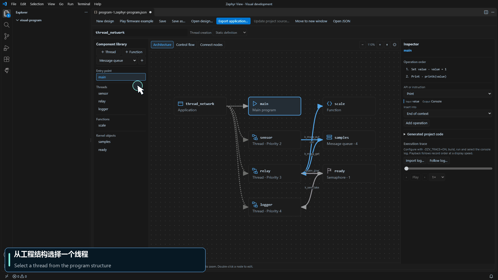
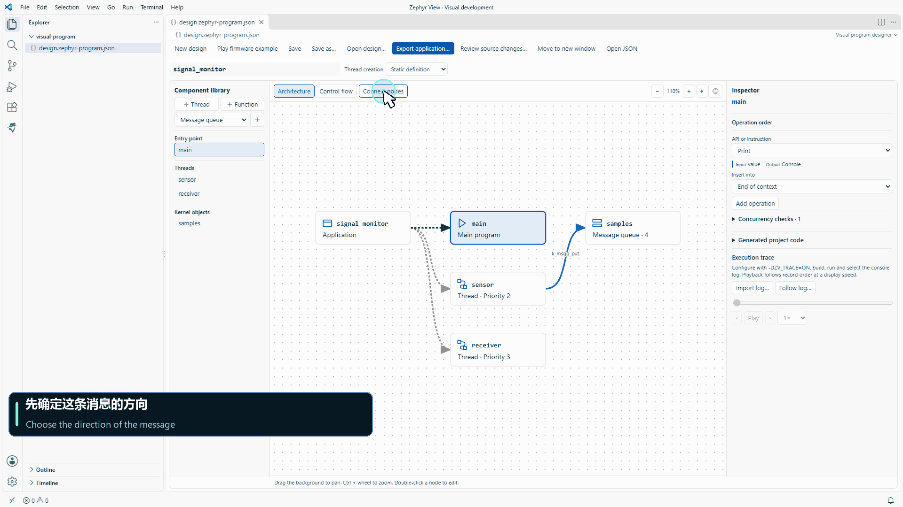

# Follow a message through a visual program

[简体中文](visual-program.md) | **English**

Open **Zephyr View → Visual program designer** from the Activity Bar. Select **Play firmware example** to open a separate design document with its matching QEMU recording. Both ship with the extension and work offline. To start your own program, choose **New design** and add instructions at the `main` entry point.



## Follow the signal

1. Select `sensor` on the left and inspect **Architecture**. An arrow goes from the sending thread to the `samples` message queue. A second arrow goes from the queue to the receiving thread `relay`. Select a connection to inspect its operation.
2. Pause the **Execution trace** on the right and step through the records. Find **42** at the `publish` send and **42** again at the `read` receive. Inside `scale`, the condition succeeds and `double` produces **84**. Expand **Generated project code** to follow the corresponding C line.
3. Switch to **Control flow** and select `scale`. Both outcomes of the condition appear in the design. The recording highlights the branch taken on this run. The `ready` semaphore passes a permit. A value shown at give or take belongs to that thread. The `counter` mutex protects a shared counter update.

Organize entry points, threads, functions and kernel objects on the left. Inspect the relationships and local control flow in the center. Edit properties, instruction order and arguments on the right. Drag the background to pan, use Ctrl + wheel to zoom, or use the canvas toolbar to fit the diagram or find the selection. Choose **Move to new window** for a larger canvas. In a narrow editor, the library and inspector open separately.

## Exercise: move an operation to another branch

1. **Save as** a copy of the firmware example. Open **Control flow** and select the `double` step in `scale`. Expand **Move selected step…** on the right. Pick the same function, the other branch of the condition and an insertion position, then select **Move step**. Select the `samples` queue in the architecture and choose one of its **Accesses** to go to the sender or receiver.
2. Delete the send step in `sensor` from your copy and expand **Concurrency checks**. Select the wait risk to locate the receive on the empty queue. To restore its peer, choose **Connect nodes**, select `sensor` and then `samples`, check that the proposed API is `k_msgq_put`, and choose **Confirm connection**. Check the findings again.
3. For an operation in a shared function, **Accesses** lists the entry points and threads that can reach it through calls. These checks cover the graph. Drivers, interrupts and hand-written C may supply additional peers. With only senders, the queue can buffer messages up to its capacity before the next send has to wait. You can still export a design with these findings.



## Edit the design and build the program

1. Reopen the original firmware example and save a fresh copy. Change the initial value of `sensor` to `5`. Inspect the threshold of `40` in `scale` and the `+1` operation on the other branch. When rebuilt, this case should produce `6`.
2. Add a thread, function or kernel object in the library. Choose **Connect nodes**, select the source and destination, then inspect the direction, operation and kernel API on the right and choose **Confirm connection**. Connecting a thread to a queue sends a message. Reversing the endpoints adds a receive. In a thread, function or main entry you can add calculations, calls, delays, conditions or bounded loops and change their order. For hardware access, add a driver hook and implement the corresponding `uint32_t zv_hook_<name>(uint32_t value)` in `src/user_hooks.c`. It can call your Zephyr driver and return a reading.
3. **Save** writes the design document. **Save as** makes a separately editable copy. **Export application** creates a new application under a parent folder of your choice. It contains `CMakeLists.txt`, `prj.conf`, `src/main.c`, `src/user_hooks.c` and `design.zephyr-program.json`. Open that design later and select **Update project source** to compare the current `src/main.c` with the proposed C in a VS Code diff. **Apply reviewed changes** saves the design and updates the source. If the C file has local edits, export a copy and compare the changes. Review a fresh diff if the design or source changes during review.
4. Open the exported application, choose a board and select a build method in the workbench. Add the CMake definition `ZV_TRACE=ON` to record events. From the application directory in a configured Zephyr environment, run either example below. For local sources and modules, see the [offline CMake guide](cmake-integration.en.md).

```sh
cmake -S . -B build -G Ninja -DBOARD=mps2/an386 -DZV_TRACE=ON
cmake --build build
```

```sh
west build -b mps2/an386 -d build . -- -DZV_TRACE=ON
```

## Watch your own code execute

Capture the QEMU console in a file. In PowerShell, use `cmake --build build --target run 2>&1 | Tee-Object -FilePath run.log`. In Bash, use `cmake --build build --target run 2>&1 | tee run.log`. On hardware, capture the firmware console with a serial terminal. Select **Follow log** to see appended events or **Import log** to inspect a finished capture. Playback speed controls the viewing interval. A static import accepts up to 4 MiB.

The bundled v2 capture contains 18 events. When `relay` calls `scale`, `call-enter` shows the input of 42 and `call-return` shows the result of 84. Older v1 captures record only the return and still play back. To inspect an exported application, open its `design.zephyr-program.json`, choose a file under **Generated project code**, then select **Open project file**. When `src/main.c` matches the preview, VS Code selects the step’s source line. If it differs, the editor opens the actual file and prompts you to review the changes.

Each highlight uses the step, thread context and value printed by firmware. The graph fingerprint matches program structure. Verify the running firmware version separately when changing build options or drivers. Rebuild and capture again after editing the graph. For live stack frames, arguments and locals at a breakpoint, see the [thread debugging exercise](threads.en.md).

[简体中文](visual-program.md) | **English**
