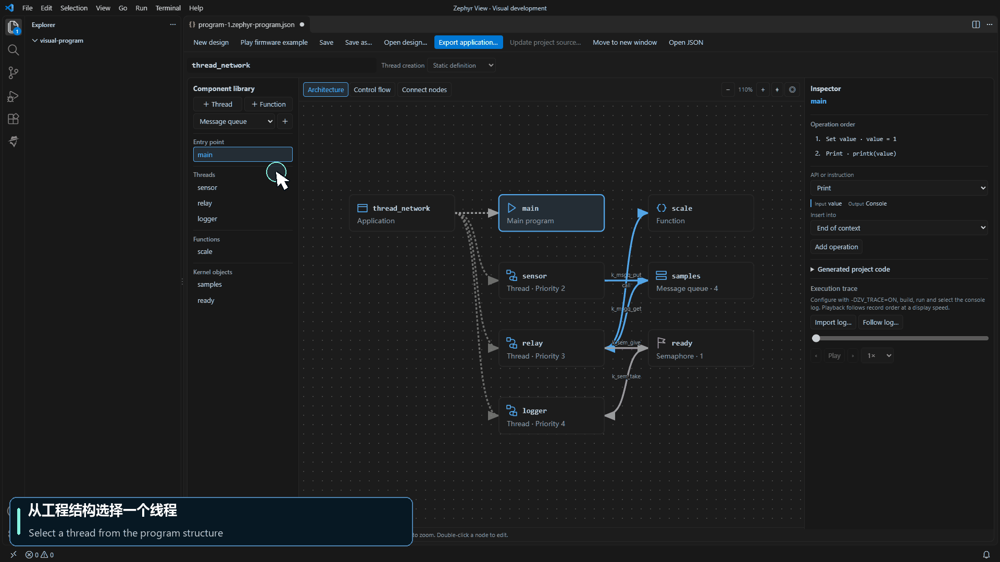
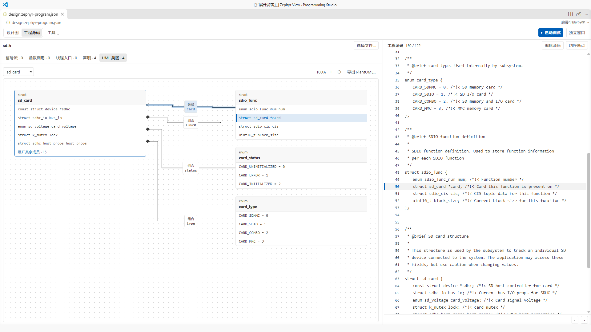
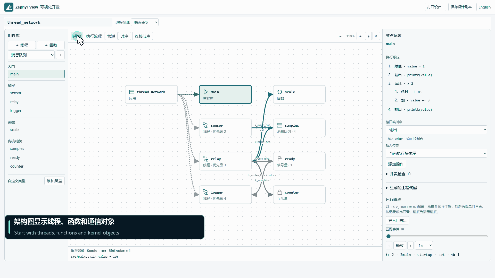
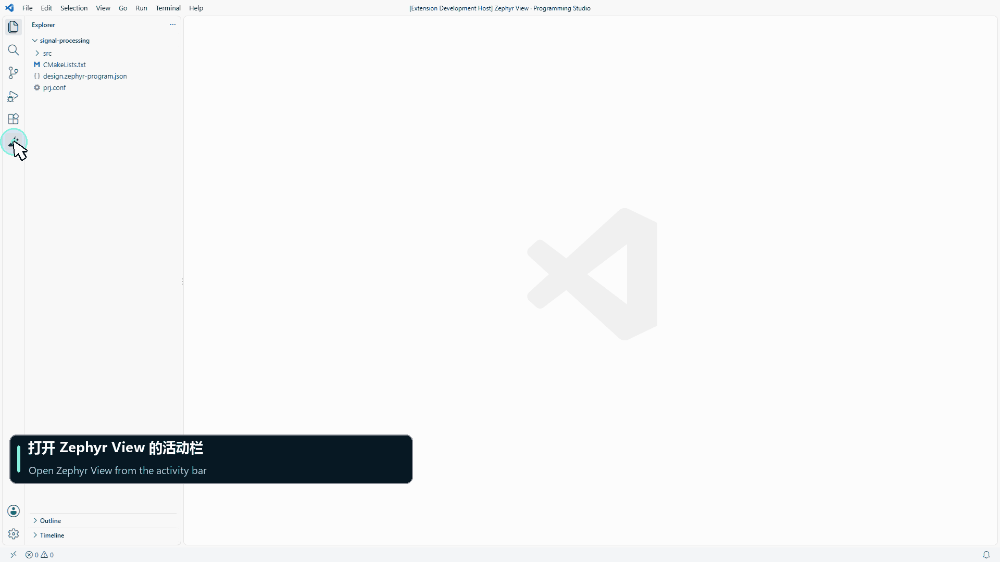
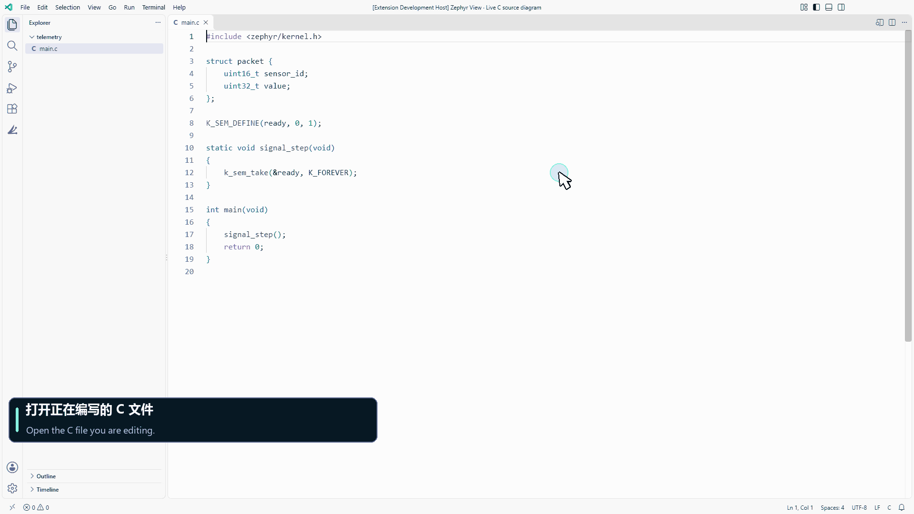
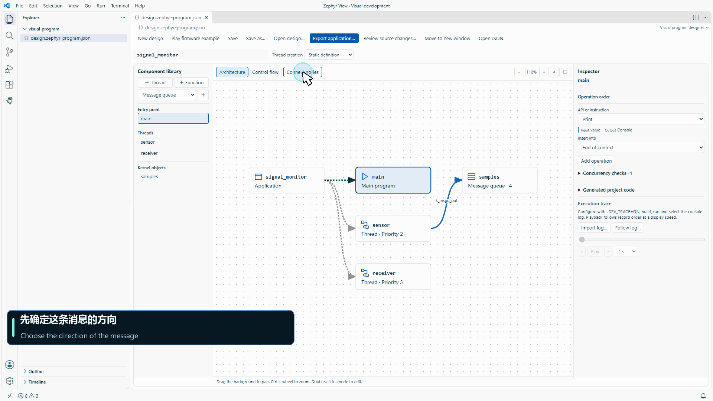

# 在程序设计器里跟踪一条消息

**简体中文** | [English](visual-program.en.md)

从活动栏打开 **Zephyr View → 打开编程工作室**。在独立窗口选择 **文件 → 播放固件示例**，扩展会在独立的设计文档里载入随包提供的图和一次 QEMU 运行记录。这个练习可以离线完成。要从头写自己的程序，点 **新建设计**，从 `main` 入口开始添加指令。



## 看清一条信号的去向

1. 在左侧选 `sensor`，看中央**架构**。箭头从发送线程指向消息队列 `samples`，再从队列指向接收线程 `relay`。选中连线可检查它使用的操作。
2. 在右侧「回放」暂停，用前后按钮逐条看。先找到 `publish` 发送的 **42**，然后是 `read` 取出的 **42**。进入 `scale`，条件成立，`double` 这一条的值变成 **84**。观察「生成源码」高亮的 C 行。
3. 切到**执行流程**，选择函数 `scale`。图上能同时看到条件的两个出口。这份运行记录只高亮实际走过的一支。通知线程的 `ready` 是信号量，传递许可；记录在 give/take 旁的数是该线程当时的局部值。互斥量 `counter` 保护一次共享计数更新。

在左侧组件库选择入口、线程、函数或内核对象。拖动画布空白处可平移，Ctrl + 滚轮可缩放。找不到刚才选中的节点时，用画布工具栏定位选区或显示全图。在右侧**属性**可修改步骤次序和参数。

## 用 UML 类图读懂 SD 卡的数据结构

在**编程工作室 → 工程源码 → 选择文件…**打开 Zephyr 源码中的 `include/zephyr/sd/sd.h`，切换到 **UML 类图**。从 `sd_card` 找到成员 `func0`。实心菱形在 `sd_card` 一端，因为卡结构体按值存放一个 `sdio_func`。沿另一方向找 `card`，点击这条关联可以在右侧看到 `struct sd_card *card`。这个字段用指针找到所属的卡。分别点击类型名、成员和关系，可以核对各自的声明。[Zephyr 示例头文件](https://github.com/zephyrproject-rtos/zephyr/blob/25c8f4a23988dd3b2cfb463613622738298c2d6c/include/zephyr/sd/sd.h)



左上角的类型选择器决定图的中心。画布只展开与它直接相连的类型，超过四个邻接类型时可翻页。点击“展开其余成员”查看完整成员列表。拖动空白处平移，按住 Ctrl 滚轮缩放，用定位按钮回到当前类型。

需要将类图交给同事时，点击**导出 PlantUML…**，在保存窗口选择 `.puml` 文件。文件包含当前文件可识别的类型和关系。已安装 PlantUML 插件时，保存后可点**用 PlantUML 预览**；该操作使用此插件配置的本地或服务器渲染方式。工程内的浏览和导出均可离线使用。[PlantUML 插件说明](https://marketplace.visualstudio.com/items?itemName=jebbs.plantuml)

## 切换管道、时序和执行流程

在**播放固件示例**里切到**管道**，沿 `sensor → samples → relay` 查看生产者、缓冲区和消费者。点击访问端可回到操作所在的步骤。要查某次运行中为什么收到某个值，切到**时序**，选中 `scale` 的调用或返回，可定位输入 `42` 和输出 `84`。纵向顺序取自固件记录。测量执行耗时需要带时间戳的采集数据。再切到**执行流程**，展开相应函数检查条件的两个出口。



## 在同一窗口对照设计、工程源码和调试现场

1. 把工作室拖到第二块屏幕或最大化。再次点击入口会回到已打开的设计。左边点一个条件、函数或队列操作，右边的**生成源码**会高亮该操作对应的行。拖动分隔线可为长函数留出更多宽度，下方可切换属性、检查和回放。
2. 看已有工程时，切到**工程源码**。工作室优先显示本工程已打开的 C/C++ 文件，也能识别应用的 `src/main.c`。通过**选择文件…**搜索工程或浏览磁盘。展开类型中的结构体、联合体或位域，点击成员即可在右侧看到声明。点击**编辑源码**可用原生编辑器修改，工作室会跟随未保存的输入更新。
3. 在右侧选择可执行语句并点击**切换断点**，然后用**启动调试**选择工程的调试配置。暂停后可继续、逐过程、步入、跳出或定位栈帧。有多个会话时，先选择要操作的会话。使用 Cortex-Debug 的工程可沿用已有的适配器、探针和调试配置。
4. 图中的信号和调用来自当前文件。输入暂时缺少括号时，工作室保留上次可解析的图；恢复有效语法后再从图跳转。跨文件宏展开、间接调用的实际目标和运行时数值，需要结合工程的编译配置或调试会话核对。



## 自定义标志并验证高位运算

选择 **新建设计 → 枚举与位标志**。示例在类型库中定义了 `Status.ready = 1` 和 `Status.alarm = 2147483648`。回放随包的固件记录，可以看到按位或得到 `2147483649`，用 `alarm` 取掩码得到 `2147483648`，右移 31 位后输出 `1`。

在类型库中新建枚举并添加成员，再在指令属性的**操作数类型**中选该类型和成员。枚举使用 32 位无符号值，可在计算和条件中复用。重命名后已有引用会跟随更新。删除前先把引用该成员的指令改到其他值。

## 一边写源码，一边看图

打开应用里的 `.c` 或 `.h` 文件，点击编辑器右上角的预览图标，或从命令面板打开**实时 C 源码图**。在源码编辑器中把 `k_sem_take(&ready, K_FOREVER)` 改为 `k_sem_give(&ready)`，预览会根据未保存的文本改变信号方向。切换视图可查看当前文件的函数调用、线程入口或类型声明。展开结构体、联合体和枚举可以查看成员，点击源码位置可以返回定义。输入未闭合时，预览保留上一张有效图并提示原因。运行时实际走过的路径可用固件时序图核对。

如果编辑的是 `.zephyr-program.json`，在设计器点**并排编辑 JSON**。设计器和文本共享同一份文档和撤销历史。暂时写到一半的 JSON 会保留有效图并暂停画布编辑，补全后即可继续。



## 动手练习：把消息改到另一个分支

1. 将固件示例**另存为**，切到**执行流程**，选择 `scale` 的 `double` 步骤。在右侧展开 **移动所选步骤…**，选择同一函数、条件的另一分支和插入位置，点 **移动步骤**。再从架构图里选择 `samples` 队列，查看右侧**访问端**，点一次即可回到对应线程的发送或接收步骤。
2. 在副本中删除 `sensor` 的发送步骤，展开**并发检查**。选中等待风险，可以定位空队列上的接收并看到缺少什么操作。恢复时选择 **连接节点**，从 `sensor` 连到 `samples`，核对 `k_msgq_put` 后点 **确认连接**。发送端恢复后再次查看检查结果。
3. 如果操作定义在共享函数内，「访问端」会列出可沿调用链到达它的入口和线程。检查只覆盖图内代码。外设、中断和手写 C 可能提供其他访问端。只有发送端时，队列可先缓冲到容量上限，下一次发送才会等待。此类提示可以帮助检查设计，仍允许导出。



## 修改图并构建自己的程序

1. 再次打开原始固件示例，另存一份副本。在 `sensor` 的属性中把初始值改为 `5`。检查 `scale` 的条件值 `40` 和另一支的 `+1`。构建后，这次的预期结果是 `6`。
2. 可在左侧新增线程、函数和内核对象；在画布选择 **连接节点** 并依次选起点和终点，检查右侧提案中的方向、操作和内核 API，再点 **确认连接**。从线程连到队列表示发送，从队列连到线程表示接收。在线程、函数或主入口中加入计算、调用、延时、条件或有限循环，调整执行次序。驱动调用使用「调用驱动接口」步骤，在 `src/user_hooks.c` 实现对应的 `uint32_t zv_hook_<名称>(uint32_t value)`。这里可以调用自己的 Zephyr 驱动并返回测量值。
3. **保存**写入设计文档，**另存为**保留可独立修改的副本。选择 **导出新应用** 并指定父目录。新目录包含 `CMakeLists.txt`、`prj.conf`、`src/main.c`、`src/user_hooks.c` 和 `design.zephyr-program.json`。以后打开该图编辑，选 **更新工程源码**，在 VS Code 差异视图里核对当前 `src/main.c` 与设计生成的版本。点 **应用已审查的修改** 才会保存设计并更新源码。遇到手工修改，可导出新副本逐段比较。审查期间若设计或源码改变，请重新查看差异。
4. 打开导出的应用，用工作台选择板和构建方式。查看轨迹时加入 CMake 定义 `ZV_TRACE=ON`。下面的命令以应用目录为起点，在已配置的 Zephyr 环境中选择一组执行。使用本地源码和模块的准备方法见[离线 CMake 指南](cmake-integration.md)。

```sh
cmake -S . -B build -G Ninja -DBOARD=mps2/an386 -DZV_TRACE=ON
cmake --build build
```

```sh
west build -b mps2/an386 -d build . -- -DZV_TRACE=ON
```

## 让自己的代码动起来

在终端把 QEMU 控制台输出保存到文件。PowerShell 可用 `cmake --build build --target run 2>&1 | Tee-Object -FilePath run.log`，Bash 可用 `cmake --build build --target run 2>&1 | tee run.log`。真板可用串口工具保存同一固件的控制台输出。回到设计器选择 **跟踪日志** 观察追加的事件，或选 **导入日志** 检查已完成的记录。回放间隔可调，表示观看速度。导入的静态片段上限为 4 MiB。

随包的 v2 实录共有 18 条事件。`relay` 调用 `scale` 时，`call-enter` 显示输入 42，`call-return` 显示返回 84。旧版 v1 日志仍可回放，只有返回记录。若要阅读导出工程，打开其中的 `design.zephyr-program.json`，在 **生成源码** 选文件并点 **打开源码**。`src/main.c` 与预览匹配时会定位所选步骤；源码有差异时会打开实际文件并提示重新审查。

高亮依据固件打印的步骤、线程上下文和数值。图指纹用于匹配程序结构；更换编译选项或驱动时还须核对实际运行的固件版本。修改图后请重新构建和采集。断点处的真实栈帧、参数和局部变量可在[线程与调试练习](threads.md)中查看。

**简体中文** | [English](visual-program.en.md)
