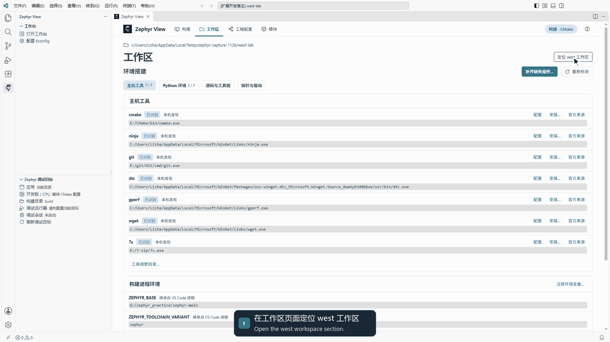

# Getting started with west workspaces

[简体中文](west-workspace.md) | **English**

A west workspace is a collection of Git repositories managed by a manifest. Its root directory (the `topdir`) contains a hidden `.west` directory. In `.west/config`, `manifest.path` locates the manifest repository and `manifest.file` names the file within it, defaulting to `west.yml`. Open **Zephyr View → Workspace → west workspace** to create or reopen a workspace, check the paths, or repair a manifest location. [West configuration reference](https://docs.zephyrproject.org/west/latest/config.html)



## Practice with a local manifest

Install Git and west first. Run `git --version` and `west --version` in a terminal, or check the tool paths in **Workspace → Environment setup**. An empty practice directory and a small manifest are enough for this exercise. It requires no SDK or module downloads.

1. Create a directory called `west-lab` anywhere, with a subdirectory named `product-manifest`. Open `west-lab` in VS Code.
2. Create `product-manifest/west.yml`, add the contents below and save the file. This example registers only the manifest repository itself, so there are no other modules in the list.
3. In **west workspace**, choose **Initialize… → Use a local manifest repository (offline)**, select `product-manifest`, then select `west.yml`. If the manifest is stored under a different name, such as `manifests/product.yml`, use **Choose another file…** and locate the file inside that repository.
4. Confirm that the destination is `west-lab`. After initialization, the panel should show that directory as `topdir` and display the selected manifest path. Choose **Inspect manifest** to see the project list reported by west in the task terminal.

```yaml
manifest:
  projects: []
  self:
    path: product-manifest
```

Alternatively, run the first command below from `west-lab` to initialize the workspace in the terminal. The remaining commands verify the result of either method.

```shell
west init -l product-manifest
west topdir
west manifest --path
west manifest --validate
west list -f "{name} {path}"
```

The validation command should exit successfully, and the list should contain `manifest product-manifest`. Local initialization creates `.west/config` in the parent of the selected manifest repository. If you open an application subdirectory later, the workbench walks up from that directory to the nearest `.west` directory.

## Clone a manifest or open an existing workspace

- **Create from Git.** Choose **Initialize… → Clone a manifest repository from Git**. Select or create an empty directory, enter the repository URL, a branch or tag, and the manifest filename within that repository. Leave the revision empty to use the remote default branch. The workbench runs `west init -m <URL> [--mr <branch-or-tag>] --mf <manifest-file> <empty-directory>`. After initialization, open **Modules** to review the requested revisions and synchronize the projects you need. A local Git mirror works for this exercise too. [West initialization reference](https://docs.zephyrproject.org/west/latest/built-in.html#west-init)
- **Open an existing workspace.** Choose **Open existing workspace** and select its root or an application directory inside it. **Enter path…** accepts an absolute path or one relative to the current VS Code project directory. The workbench opens the detected root and reads its configuration and manifest. If two workspaces sit side by side, select the directory belonging to the one you want.
- **Check imported projects.** When a manifest uses `import`, west needs the local contents of the relevant repositories to resolve the imports. With west available and the imports resolved, the panel shows the effective manifest projects. A partial result is labeled as directly declared projects only. Provide local repositories at the revisions specified by your team or synchronize the required modules, then select **Reread workspace** and inspect the manifest again.

## Repair a moved manifest

To try this in your practice workspace, rename `product-manifest` to `product-manifest-new`, then reopen `west-lab`. The panel will report the previous manifest path.

1. Choose **Repair manifest location…** in **west workspace**. Select `product-manifest-new` and its `west.yml`.
2. Review the configuration filename and the `path` and `file` values. Choose **Save manifest location**. The repair changes those two location settings, retaining other sections, comments and line endings in an existing file. If the editor has unsaved changes, resolve them first.
3. Run `west manifest --path` and `west manifest --validate` again. The first command should point into the renamed directory and the second should exit successfully. The next time you open the workspace, it will use the repaired location.

For a YAML syntax error, open the file named in the diagnostic and fix the affected entry. If `.west` exists but `config` is missing, the same repair action can recreate the manifest location. Restore any custom group filters or build settings from your backup. If the entire `.west` directory is gone, initialize again using the existing local manifest repository. [Return to Getting started](../GETTING_STARTED.en.md)

[简体中文](west-workspace.md) | **English**
