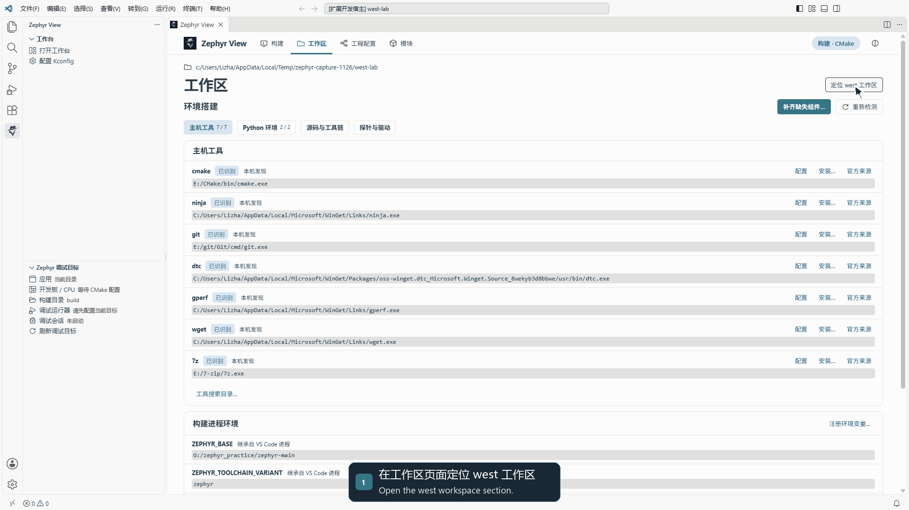

# west 工作区入门

**简体中文** | [English](west-workspace.en.md)

west 工作区是由一份清单管理的一组 Git 仓库。工作区根目录（`topdir`）有一个隐藏的 `.west` 目录。`.west/config` 里的 `manifest.path` 指向清单仓库，`manifest.file` 指向该仓库内的清单文件，默认文件名是 `west.yml`。打开 **Zephyr View → 工作区 → west 工作区**，可以在这里创建工作区、重新打开已有工作区、核对路径或修复清单位置。[west 官方配置说明](https://docs.zephyrproject.org/west/latest/config.html)



## 用本地清单练习

准备条件是已安装 Git 和 west。打开终端运行 `git --version` 和 `west --version`，或在工作台的「工作区 → 环境搭建」核对工具路径。先用一个空白练习目录和一份很小的清单体验整个流程，无需下载 SDK 或模块。

1. 在任意位置新建目录 `west-lab`，在其中新建子目录 `product-manifest`。用 VS Code 打开 `west-lab`。
2. 在 `product-manifest` 中创建 `west.yml`，写入下方内容并保存。这个例子只登记清单自身，因此列表里没有其他模块。
3. 在「west 工作区」点 **初始化… → 使用本地清单仓库（离线）**，选择 `product-manifest`，再点 `west.yml`。如果清单放在例如 `manifests/product.yml`，选「选择其他文件…」并在仓库内定位该文件。
4. 确认对话框中的目录为 `west-lab`。初始化结束后，本节应显示该目录为 `topdir`，清单路径指向所选文件。点「检查清单」，可以在任务终端看到 west 返回的项目列表。

```yaml
manifest:
  projects: []
  self:
    path: product-manifest
```

也可从 `west-lab` 终端执行等价的初始化命令，下面第一行与界面初始化任选其一。其余命令可用来核对结果。

```shell
west init -l product-manifest
west topdir
west manifest --path
west manifest --validate
west list -f "{name} {path}"
```

预期结果是 `west manifest --validate` 成功退出，列表中有 `manifest product-manifest`。本地初始化会在清单仓库的父目录中创建 `.west/config`。即使最初打开的是某个应用子目录，工作台也会从它逐级向上找最近的 `.west` 目录。

## 从 Git 新建或打开已有工作区

- **从 Git 新建。** 点「初始化… → 从 Git 仓库克隆清单」，选择或新建空目录，填写仓库地址、分支或标签，以及仓库内的清单文件。版本留空使用远端默认分支。界面执行 `west init -m <URL> [--mr <分支或标签>] --mf <清单文件> <空目录>`。初始化完成后，到「模块」核对清单要求的版本并同步需要的项目。可使用本地 Git 镜像地址完成相同练习。[west 官方初始化命令](https://docs.zephyrproject.org/west/latest/built-in.html#west-init)
- **打开已有工作区。** 点「打开已有工作区」，在目录选择器里选根目录或内部的应用目录。也可用「输入路径…」输入绝对路径，或相对于当前 VS Code 工程目录的路径。工作台打开识别到的根目录，重新读取 `.west/config` 和清单。两个工作区同级存放时，选中要用的那个目录。
- **核对导入的项目。** 清单有 `import` 时，west 需要相应仓库的本地内容来解析导入。能调用 west 且解析成功时界面显示有效清单项目；导入未解析时会标记列表只包含直接声明的项目。按团队清单提供的版本准备本地仓库或同步所需模块，然后点击「重新读取」，再检查清单。

## 修复移动过的清单

可以用刚才的练习目录验证修复。将 `product-manifest` 重命名为 `product-manifest-new`，然后重新打开 `west-lab`。界面会显示原清单的无效路径。

1. 在「west 工作区」点 **修复清单位置…**，选择 `product-manifest-new` 和其中的 `west.yml`。
2. 核对确认框列出的配置文件、`path` 和 `file`，再点「保存清单位置」。这一步只修改这两个清单定位项。已有配置文件的其他节、注释和换行会保留。有未保存编辑时请先处理这些编辑，再进行修复。
3. 再运行 `west manifest --path` 和 `west manifest --validate`。前者应指向新目录，后者应成功退出。下次打开工作区会沿用该位置。

如果出错的是 YAML 语法，打开诊断中列出的文件并修正对应条目。如果 `.west` 还在但 `config` 缺失，可由同一修复入口重建清单位置；组筛选、构建参数等自定义设置需要从原备份恢复。若整个 `.west` 都已丢失，可以用仍然存在的本地清单仓库重新初始化。[返回新手手册](../GETTING_STARTED.md)

**简体中文** | [English](west-workspace.en.md)
